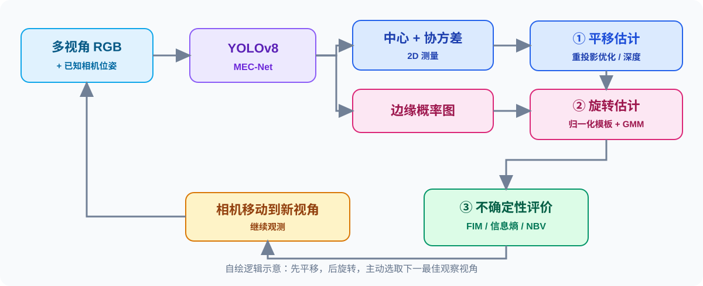

# Active 6D Pose Estimation for Textureless Objects using Multi-View RGB Frames

**作者**：Jun Yang、Wenjie Xue、Sahar Ghavidel、Steven L. Waslander  
**预印本**：arXiv:2503.03726（v2，2025-12-15）  
**期刊**：*The International Journal of Robotics Research*，2026（online 2026-01-27）  
**DOI**：[10.1177/02783649251411922](https://doi.org/10.1177/02783649251411922)  
**分类**：Robotics → Active Perception  
**阅读时间**：2026-11-11（首轮）；后续继续更新

> 一句话：先用多视角 RGB 确定物体的三维**平移**，再用标准尺度轮廓模板求**旋转**，最后以不确定性驱动相机选取**下一最佳视角**。

## 阅读入口

- 📄 [原文 PDF（arXiv v2，工作流下载后可用）](paper.pdf) · [arXiv 原文页面](https://arxiv.org/abs/2503.03726) · [直接打开原始 PDF](https://arxiv.org/pdf/2503.03726v2)
- 📖 [中文精读与图解](notes/explainer.zh-CN.md)
- 💬 [对话、补充说明与勘误](notes/dialogue.md)
- 🎥 [作者项目主页](https://trailab.github.io/ActiveODPE/) · [arXiv HTML](https://arxiv.org/html/2503.03726)

## 核心贡献（本人的阅读摘要）

1. **平移—旋转的顺序解耦**：多视角中心重投影求平移与尺度，再做尺度归一化的姿态模板匹配。
2. **面向歧义的概率建模**：旋转采用多峰假设与 max-mixture 优化，并显式考虑物体几何对称性。
3. **基于信息的主动感知**：以 Fisher 信息/协方差近似预测候选视角，选择位姿不确定性更小的视角。
4. **实验验证**：ROBI、TOD 与作者提出的 T-ROBI 透明物体数据集。

## 研究关联

适合从视觉几何与不确定性建模的角度参考。迁移到柔性线缆需要将刚体的 SE(3) 位姿更换为线缆形状、端点、接触状态等非刚体状态变量；不能直接套用 CAD 刚体模板。

## 原文许可与署名

© 原文作者 Jun Yang、Wenjie Xue、Sahar Ghavidel、Steven L. Waslander。归档原文为未经改写的 **arXiv v2**（不是期刊排版 PDF），从 arXiv 下载；原文许可：[CC BY-NC-SA 4.0](https://creativecommons.org/licenses/by-nc-sa/4.0/)：须署名、非商业、相同方式共享。此处的 SVG 为基于阅读内容自行绘制的解释图，并非原文插图或实验结果；图示与中文改写按同一 CC BY-NC-SA 4.0 条款分享。原始来源：[arxiv.org/abs/2503.03726](https://arxiv.org/abs/2503.03726)。

