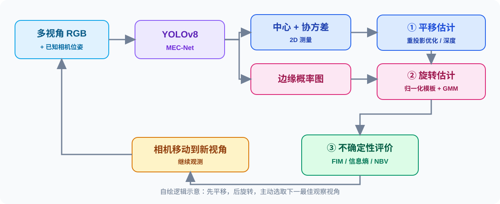
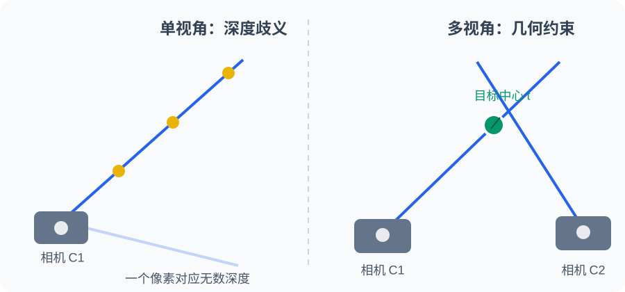
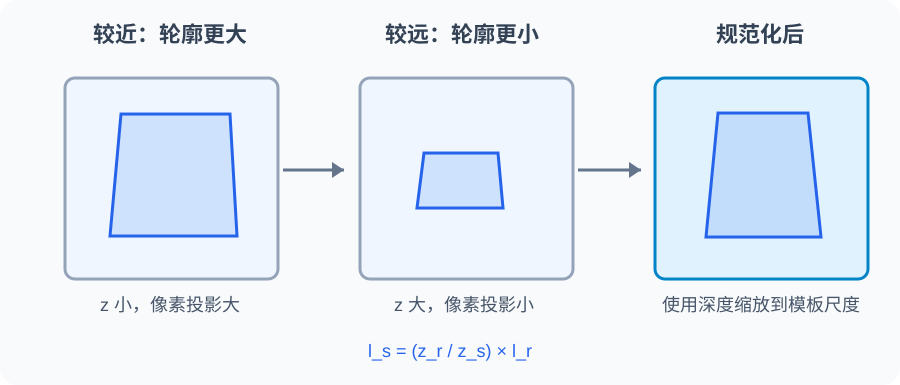
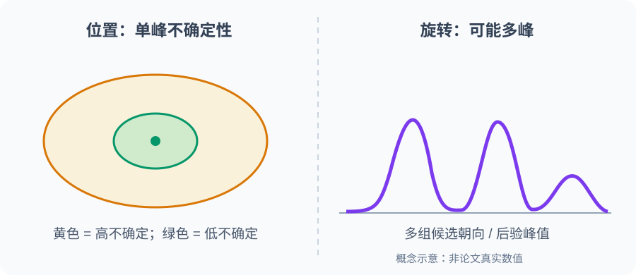
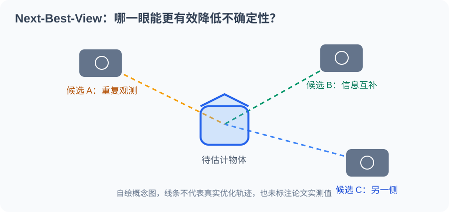

# 论文精读：Active 6D Pose Estimation for Textureless Objects using Multi-View RGB Frames

**中文题目**：基于多视角 RGB 图像的无纹理物体主动六自由度位姿估计  
**作者**：Jun Yang, Wenjie Xue, Sahar Ghavidel, Steven L. Waslander  
**依据版本**：arXiv v2（2025-12-15）；期刊在线发表时间为 2026-01-27。  
**原文**：[arXiv 摘要](https://arxiv.org/abs/2503.03726) · [arXiv PDF](../paper.pdf) · [项目主页](https://trailab.github.io/ActiveODPE/)

> **总纲**：先确定物体 **WHERE（位置）**，再确定 **HOW（旋转）**，最后决定 **WHERE TO LOOK NEXT（下一视角）**。

## 一、为什么研究无纹理物体的 6D 位姿？

刚体六自由度位姿由三维平移和三维旋转构成：

$$
T_{wo}=\begin{bmatrix}R_{wo}&t_{wo}\\0^\top&1\end{bmatrix}\in SE(3),
\quad t_{wo}\in\mathbb R^3,\ R_{wo}\in SO(3).
$$

- 平移 $t$：物体的几何中心在哪里？三个自由度。
- 旋转 $R$：物体如何朝向？三个独立自由度。
- **无纹理物体的难点**：缺少角点/局部纹理，严重反光、透明物体深度缺失、遮挡、几何对称性、单视角尺度与深度歧义。
- 一般 RGB-D 可直接利用深度；但金属反光与透明件使深度图变得不可信，多视角 RGB 在这时有特殊价值。

**不是通用无先验方法**：论文需要已知 CAD 物体模型与相机位姿（机械臂运动学+手眼标定或 SLAM）；对象被视为刚体。

## 二、框架：学习视觉测量，显式几何优化位姿

对每个相机视角：输入 RGB 图像，经 YOLOv8 找检测框（裁剪并缩放为 128×128），再送入基于 ResNet-18 的 **MEC-Net**。网络预测：

- 物体 Mask（分割掩码）；
- 逐像素指向物体二维中心的向量场，用 RANSAC 投票得到中心 $u_k$ 与协方差 $\Sigma_{u,k}$；
- 物体边缘概率图 Edge Map，后续用于轮廓模板匹配。

网络**不直接预测完整 SE(3) 位姿**。它提供视觉观测，后续位姿由多视角重投影与姿态模板优化获得。

~~~mermaid
flowchart TD
A["多视角 RGB 图像 + 已知相机位姿"] --> B["YOLOv8 检测 / MEC-Net"]
B --> C["二维中心 + 协方差"]
B --> D["物体边缘概率图"]
C --> E["多视角重投影优化 → 3D 平移"]
E --> F["获取深度并归一化边缘图尺度"]
D --> F
F --> G["LINE-2D 模板匹配 → 各帧旋转候选"]
G --> H["对称性 + GMM / Max-Mixture 多帧优化"]
E --> I["估计位姿的不确定性"]
H --> I
I --> J["预测候选视角不确定性"]
J --> K["选择 Next-Best-View"]
K --> A
~~~

## 三、平移：从二维中心到三维重投影优化

### 3.1 单目中心为何不能直接给出深度？

针孔成像的反投影关系：

$$
x=\frac{u-c_x}{f_x}z,\quad y=\frac{v-c_y}{f_y}z.
$$

单张 RGB 图像只给出 $u,v$，未知深度 $z$；空间中沿着同一相机射线的许多三维点均能投到这一像素。

当已知两个或更多相机位姿时，多个中心观测约束同一个空间点；噪声下射线不一定精确相交，所以进行加权最小二乘，而不是简单求交点。

### 3.2 残差与优化

第 $k$ 个相机观测：

$$
r_k(t_{wo})=\pi(T_{wc,k}^{-1} t_{wo})-u_k.
$$

其中 $\pi$ 是透视投影；当 $T^{-1}$ 作用在三维点上时，应按齐次坐标理解。

多视角目标：

$$
\boxed{
L(t_{wo})=\sum_{k=1}^{K} r_k^\top\Sigma_{u,k}^{-1}r_k
}
$$

使用 Gauss–Newton 非线性最小二乘优化。

**协方差直觉**：无遮挡中心测量集中，$\Sigma_{u,k}$ 小，权重大；遮挡导致中心不确定时，$\Sigma_{u,k}$ 大，权重小。与直接平均各帧中心相比，更符合异方差测量模型。

**隐含前提**：相机内参和外参准确；正确的跨视角目标关联；至少两个具备有效视差的初始视角。基线过短或相机轨迹退化会导致三角化不稳定。

## 四、旋转：为什么平移应当先于旋转？

### 4.1 深度先验能缩小搜索空间

如果同一个螺丝从 30 cm 和 90 cm 观看，像素尺寸不同；未确定深度时，轮廓模板匹配既要搜索角度又要搜索尺度，组合搜索很昂贵。

先估平移取得相机坐标中的深度 $z_s$，再按论文式 (11) 裁剪到标准尺度：

$$
\boxed{l_s=\frac{z_r}{z_s}l_r}
$$

$z_r$ 为渲染模板的基准距离，$l_r$ 是基准裁剪尺度，$l_s$ 为当前视角的裁剪尺度。

论文采用朝向无关的正方形 RoI，避免未解出旋转就依赖旋转进行裁剪。

### 4.2 MEC-Net 边缘图 + LINE-2D 轮廓模板

1. 离线从 CAD 物体不同角度生成模板；
2. 在线预测目标的 Edge Map；
3. 依据平移/深度重新裁剪并规范尺度；
4. 用 LINE-2D 取得每一帧的旋转候选；
5. 跨视角融合旋转，并显式处理物体几何对称性。

网络提供的**物体边缘概率图**可以屏蔽部分背景梯度与金属高光产生的虚假边缘；训练阶段通过遮挡增强提升鲁棒性。

### 4.3 为什么只取一个旋转角度不够？

齿轮和外观接近对称的物体可能拥有多个同样合理的姿态；遮挡也会让不同姿态的轮廓相似。要区分：

- **真正的几何对称**：旋转后的物体形状等价，需根据 CAD 几何在评估与优化时消除等价性；
- **观测引起的多解**：不同的实际姿态在现有图像下难以区分，新增视角可能消除歧义。

论文以 GMM 表达可能的旋转候选，使用 max-mixture 形式简化多帧优化：

$$
p(R)\approx\sum_i w_i\,\mathcal N(\mu_i,\Sigma_i),\qquad
p(z\mid R)\approx \max_i [w_i\mathcal N_i].
$$

严格地说，旋转分布是建立在 $SO(3)$ 的局部切空间中的近似；此式只是帮助理解的概率模型示意，不应将 $SO(3)$ 当作全局欧几里得空间。

旋转误差在局部切空间表达：

$$
r_k(R)=\log\big(\bar R_{co,k}^{-1}R_{wc,k}^{-1}R\big)^\vee.
$$

$\log$ 为李群对数映射，$\vee$ 把反对称矩阵转换为三维向量。在三维切空间做 Gauss–Newton 优化，比逐元素平均旋转矩阵更有几何意义。

## 五、主动感知：为什么下一视角要依据不确定性选择？

### 5.1 随机、远距离与信息驱动的区别

- Random：随机选候选相机位姿；
- Max-Distance：选离过去观测最远的候选视角；
- NBV：选**预计位姿不确定性最低**的视角。

### 5.2 Fisher Information 与协方差近似

论文利用加权测量雅可比近似当前信息矩阵，其逆近似估计协方差：

$$
\boxed{\Sigma \approx (J^\top\Sigma_z^{-1}J)^{-1}}
$$

新视角若提供与已有视角互补的独立约束，信息矩阵会变得更充分，协方差通常减小。

单峰三维高斯熵：

$$
h(\Sigma)=\tfrac12\ln((2\pi e)^3|\Sigma|).
$$

对旋转的多峰模型，使用 GMM 微分熵的上界近似：

$$
h_\phi^u=\sum_i w_i\left[-\ln w_i+\tfrac12\ln((2\pi e)^3|\Sigma_i|)\right].
$$

选择候选视角 $v$：

$$
\boxed{
v^*=\arg\min_{v\in \mathcal V}
\left[g_t h_t(v)+g_\phi h_\phi^u(v)\right].
}
$$

其中 $g_t,g_\phi$ 调整平移与旋转不确定性的权重。算法先用至少两帧初始化，然后重复「估计位姿及不确定性 → 评价候选视角 → 移动 → 观测 → 更新」。

**关键限制**：预测未来信息时假设观测噪声近似不变，并利用当前估计计算未来视角的雅可比。对遮挡比例明显变化的视角，这种近似未必准确。NBV 主要缩小现有估计的协方差，尚未显式最大化不同旋转假设之间的辨别信息。

## 六、实验与结果

数据集：ROBI（工业金属件）、T-ROBI（作者构建的透明物体料箱数据集）、TOD（透明物体）。采用 ADD*（考虑对称性的模型点距离准则）和更严格的 5 mm / 10°。

### 6.1 论文方法的 ADD* 正确检测率

| 数据集 | 4 视角 | 8 视角 |
| --- | ---: | ---: |
| ROBI / Ensenso | 86.4% | 90.9% |
| ROBI / RealSense | 82.9% | 90.1% |
| T-ROBI | 93.4% | 95.2% |
| TOD | — | 97.9% |

原文：Tables 2–5。**切勿误读**为本方法在任何条件下优于 RGB-D；深度质量可靠的场景，RGB-D 依然有竞争优势。

### 6.2 消融：网络边缘图与顺序解耦（原文 Table 7）

| 物体 Edge Map | 顺序优化 | 4 视角 ADD* | 单帧 LINE-2D 耗时 |
| --- | --- | ---: | ---: |
| 否 | 否 | 70.3% | 157.2 ms |
| 否 | 是 | 73.3% | 34.1 ms |
| 是 | 否 | 85.4% | 197.7 ms |
| 是 | 是 | **86.5%** | **48.5 ms** |

**解读**：加入 Edge Map 提升准确率；已知深度后的顺序式旋转估计显著减少模板搜索时间。这里的耗时是 CPU 上每物体每帧的 LINE-2D 时间，**不是端到端机器人闭环延迟**。

### 6.3 NBV 消融（原文 Table 8）

初始化 2 个视角，再加入 2 个视角，总计 4 帧，严格指标为 5 mm / 10°：

| 数据集 | Random | Max-Distance | NBV |
| --- | ---: | ---: | ---: |
| ROBI | 70.2% | 74.1% | **76.1%** |
| T-ROBI | 79.4% | **85.1%** | 84.1% |
| TOD | 79.5% | 89.3% | **90.7%** |

NBV 相比 Random 提升 ROBI 5.9 个百分点，TOD 11.2 个百分点；但在 T-ROBI 严格指标上略低于 Max-Distance。准确表述是 **NBV 整体有效、但并非所有数据集/指标的最优策略**。

## 七、方法评价：贡献、局限与可迁移思想

### 贡献

1. 将依赖关系显式编码：先平移恢复深度与尺度，再旋转，减少搜索维度；
2. 概率优化：中心协方差、多峰旋转分布、max-mixture，提高观测融合的鲁棒性；
3. 主动观察：使用位姿信息而非距离启发式选择新视角；
4. 透明/反光场景：不依赖深度相机的可靠测距，避免特定材质下的深度失效。

### 局限

- 依赖 CAD、已知相机位姿、相机内参、物体关联；
- 平移采用单峰近似，严重遮挡下也可能具有多个可能位置；
- 旋转多峰的 NBV 近似未充分解决「哪个视角最能区分两个竞争姿态」；
- 候选视角预先离散化，没有直接联合优化连续轨迹与运动代价；
- 机器人真正执行时还应考虑遮挡预测、相机可达性、安全碰撞和移动时间。

### 对机器人操作与线缆研究的启发（**延伸思考，不是论文实验**）

- 对已知 CAD 的刚体操作，可利用末端腕部相机和手眼标定，把 NBV 作为抓取前的主动感知步骤；
- 对柔性线缆，不能套用单个刚体 $SE(3)$ 旋转。应将被估计状态改成「中心线关键点/端点/接触状态/遮挡段几何」，对形状不确定性建模；
- 可将候选视角的预期信息增益与机械臂运动成本、抓取状态可见性联合优化；
- 多假设轮廓/端点估计可能比单个均值状态更适合遮挡丰富场景；
- 如果有触觉，还能让主动视觉与主动接触联合降低状态不确定性，但需另设观测模型。

## 八、三句话总结

1. **WHERE**：MEC-Net 提供二维中心及不确定性，使用已知相机位姿进行多视角重投影优化，求 3D 平移；
2. **HOW**：平移提供深度与尺度，网络边缘图通过尺度归一化与 LINE-2D 匹配形成旋转候选，多帧 max-mixture 融合；
3. **WHERE TO LOOK NEXT**：根据 Fisher 信息与位姿熵评价各候选视角，主动获取更有信息量的 RGB 图像。

## 原文定位与区分

- 论文 Sec. 3.2：多视角平移与协方差加权；
- 论文 Sec. 3.3：轮廓模板、旋转对称与 max-mixture；
- 论文 Sec. 4：NBV 的信息论设计；
- 论文 Sec. 5 / Tables 2–8：实验、消融、NBV 效果；
- 上文 SVG 均是**读者友好的概念性示意**，没有借用作者原图或伪造模型预测输出；
- 所有论文数字均注明对应表格，避免和图中教学示例混淆。

**原文版权**：Jun Yang 等，arXiv:2503.03726v2，[CC BY-NC-SA 4.0](https://creativecommons.org/licenses/by-nc-sa/4.0/)；以上中文讲解与自绘示意基于该论文整理，供非商业学术交流，按相同许可分享。

