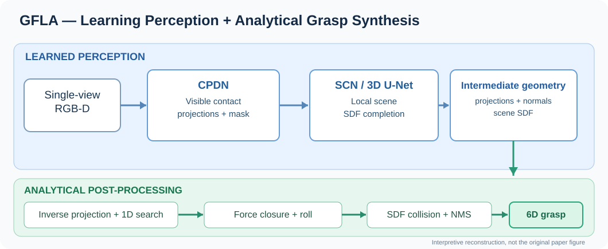

# GFLA: A Grasping Framework With Learning-Based Perception and Analytical Modeling for Single-View Scenes

**作者**：Xiao Ning、Jianzhong Yang、Si Huang、Chengzuo Guo、Enzhao Zhang  
**期刊**：*IEEE Transactions on Robotics*, Vol. 42, pp. 3141–3159 (2026)，2026-07-23 发表  
**DOI**：[10.1109/TRO.2026.3715994](https://doi.org/10.1109/TRO.2026.3715994)  
**正式页面**：[IEEE Xplore #11622692](https://ieeexplore.ieee.org/document/11622692)  
**作者源码/权重**：[Nx1021/GFLA-release](https://github.com/Nx1021/GFLA-release)  
**输入**：单视角 RGB-D；**目标**：两指平行夹爪的 6-DoF 对映抓取候选  
**首轮阅读**：2026-11-13

> **一句话理解**：网络在可见表面预测接触投影、将部分可见的场景补全为 SDF；解析后处理利用接触族恢复三维候选，再以力闭合和 SDF 碰撞检查选择可执行抓取。

## 资料

- [精读笔记、图示、实验与批判性分析](notes/explainer.zh-CN.md)
- [GFLA × Isaac Sim：Franka 仿真复现与遮挡评测方案](notes/simulation-isaacsim.md)
- [对话、补充与勘误](notes/dialogue.md)
- [接触族的降维解释](assets/contact-family.svg)
- [微信原文](https://mp.weixin.qq.com/s/pKhe56xuswkVt9PI7_Nwcg) · [网页剪藏卡片](https://cubox.pro/web/card/7520763965190702501)
- [作者仓库中的原论文示意图](https://github.com/Nx1021/GFLA-release/blob/main/doc/images/paper_intro.png) · [网络示意](https://github.com/Nx1021/GFLA-release/blob/main/doc/images/paper_network.jpg)

## 重点

1. CPDN 将不可直接求解的三维接触点对转化为图像上可预测的接触投影和置信度；代码中的 head 实际输出 6 个通道，与网页解读“5 通道”不一致，见精读中的代码核验。
2. SCN 在局部体素内预测 SDF；VASS 让表面附近、可靠可见区域的监督权重更大，以避免过强地拟合遮挡区域的不确定几何。
3. 解析阶段采样未知接触深度与接近角，计算接触法向、最小摩擦系数和碰撞；不等于全局物理稳定性保证。
4. GraspNet-1Billion RealSense mean AP 57.84、novel AP 35.88（+7.59 个百分点）；真机单物体 229/240、多物体 146/162。
5. 单视角可见接触假设、补全可信度、实例粘连、物体质心和动态接触，是需要额外考虑的限制。

## 原文 PDF / 权利说明

**尚未归档原始 PDF**。本次确认了 IEEE 论文书目及官方摘要、作者公开的 GitHub 源码和权重说明；未取得可确认许可在公开仓库再分发的正式论文 PDF。不会以自造 PDF 或二次报道代替原文。若后续找到合法可再分发版本，再更新本目录元数据并补全原文。

**证据边界**：本文精读中把“IEEE 摘要、作者 README/源码、微信文章数据、读者分析”分别标识；部分详细方法和时延只据中文报道，尚待逐式核对期刊全文。全部 SVG 是依据技术原理自行绘制的讲解示意，而非原论文的复制图或实测可视化。
