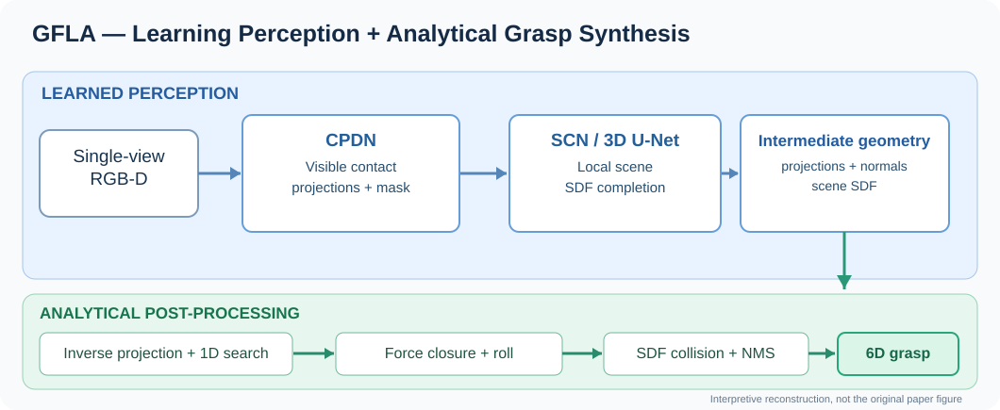
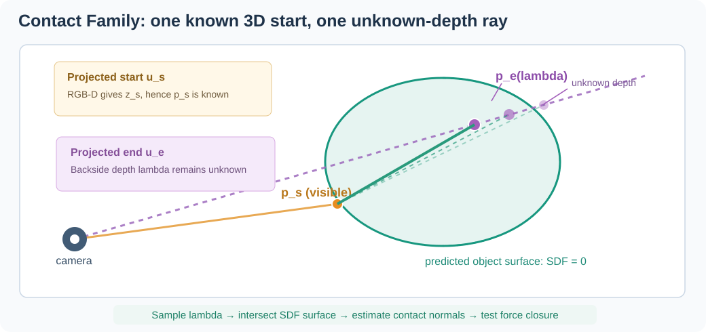

# GFLA 精读：单视角 RGB-D、接触投影、SDF 补全与解析抓取

> 首轮阅读：2026-11-13；**原文核验边界**：已核对 IEEE 正式摘要、作者 [GFLA-release](https://github.com/Nx1021/GFLA-release) 的 README、训练/推理相关代码，以及用户提供的 [中文解读](https://mp.weixin.qq.com/s/pKhe56xuswkVt9PI7_Nwcg)。由于未获得可访问、可核验的完整正式论文 PDF，本文没有把无法通过 IEEE/代码确认的细节表述为已核验的“论文原式”。所有图为原创解释示意。

## 0. 论文定位

- Xiao Ning et al., “GFLA: A Grasping Framework With Learning-Based Perception and Analytical Modeling for Single-View Scenes,” *IEEE Transactions on Robotics*, vol. 42, pp. 3141–3159, 2026.
- [IEEE DOI](https://doi.org/10.1109/TRO.2026.3715994)；[官方代码](https://github.com/Nx1021/GFLA-release)。
- 问题：只有单视角 RGB-D，只能看到局部表面，如何给未知 CAD 的物体生成可靠的两指对映 6D 抓取。
- 主要思想：感知网络预测中间几何表征，后处理根据接触法向与力闭合、夹爪碰撞对候选进行解析评价，而非端到端直接回归所有最终抓取位姿。



## 1. 两条抓取假设

**假设 A：** 很多对映夹取至少一个接触点处于可见表面；**假设 B：** 局部几何通常具有一定连续性，可由可见部分推断邻近遮挡表面。二者是作者对实际场景的有用先验，**不是对任意物体、任意相机姿态的定理**：俯视盒体、复杂凹腔和遮挡很重的情形会违反假设 A；薄片/开口壳体与线缆会显著挑战假设 B。

## 2. 网络与解析后处理分工

| 部分 | 输入 | 输出 | 职责 |
|---|---|---|---|
| CPDN（接触投影检测） | RGB-D（外观和深度特征） | 前景掩码、可见接触起点/另一端的二维投影与候选评分 | 在二维中决定哪些接触值得尝试 |
| SCN（场景补全） | 可见点云、局部体素、共享特征 | 补全的 SDF 及其空间梯度/法向 | 估计不可见的几何，支持射线交点和碰撞检查 |
| 解析后处理 | 投影、可见深度、补全 SDF、夹爪几何 | 6-DoF grasp candidates | 构造接触族，采样接近角，力闭合评分、碰撞与 NMS |

注意：作者源码中主网络名为 `CFGNet`，具体包含 `CFD`、`GPC`、`CSF` 等子模块；论文用 CPDN、SCN 描述任务模块。源码名和论文方法名并不总是一一等同。

## 3. 最重要的几何降维：Contact Family

设相机内参为 `K`，像素 `u=(u,v)` 的齐次形式为 `\tilde u=(u,v,1)^T`。CPDN 给出两个接触的图像投影 `u_s,u_e`。

可见起点的深度可由 RGB-D 得到，因而三维起点是：

```math
p_s = z_s K^{-1} \tilde{u}_s.
```

被遮挡终点的图像投影已知，但其深度 `\lambda` 未知，对应相机射线：

```math
p_e(\lambda)=\lambda K^{-1}\tilde{u}_e.
```

于是整条可能的接触连线由一维参数 `\lambda` 描述：

```math
\ell_{\lambda}(\tau)=p_s+\tau\big(p_e(\lambda)-p_s\big).
```

对每个候选 `\lambda`，利用补全 SDF 求交点/法向，形成“接触族”，再选择在物理上可行的接触对。

**细节**：这并非说从原始六自由度抓取姿态到最终结果只剩一个连续变量。首先网络要在图像空间估计投影（其中包括起止位置）；其次恢复抓取后仍需采样绕接触线的**接近角**。准确说法是：**用学习预测离散的图像候选，解析阶段把剩余难题分解成射线深度与接近角采样**。



## 4. CPDN：学习接触投影，而非回归最终抓取矩阵

中文报道描述颜色分支由 FastSAM/FSAM 风格分割特征提供，深度分支为 ResNet，多尺度融合至 1/8 图像分辨率；通过深度梯度引导的方向融合模块（DFM），偏移特征采样位置，反映夹取方向与局部表面法向的关系。

训练标签由 GraspNet-1Billion 的 6D grasp 标注变换至二维接触对；可减少专门制作像素级接触标注的成本。

**源码核验与二次报道差异**：中文网页称“5 通道：置信度+两个二维偏移”，但当前作者源码 `models/CFD.py` 的 `ContactMapHead(..., 6)`、`pred_ctt_pairs_quantify` 明确处理 **6 通道**，对应 `pred_conf`、`pred_score`、二维起点、二维终点。可能是论文与发布代码的表示方式不同，或中文总结略去了单独的候选分数；**不能在没有正式全文的情况下把此差异认定为论文错误**。

## 5. SCN 与 VASS：不把被遮挡区域当成确定真值

SCN 通过局部体素对可见点云及图像特征编码，并由 3D U-Net 预测场景有符号距离场（SDF）：
- `d(x)=0` 近似物体表面；
- `d(x)>0` 通常代表表面外侧；
- `d(x)<0` 通常代表内部。

由于单视角对背面天然不确定，中文报道解释作者设计可见性感知软监督（VASS）：根据可见/遮挡可靠性以及距可见表面的位置衰减监督权重，以免远距离不可见体素主导学习。可以概念化为

```math
\mathcal{L}_{SDF}=\sum_v w_{vis}(v)\,w_{dist}(v)\,\ell(\hat d(v),d^*(v)),
```

这只是**为理解权重机制写出的通式**，不代表已逐式核对论文实际损失函数。

源码 `cfg/config.yaml` 设置 `VolumeXYZ: [32,32,32]`、`voxel_size: 0.006`（米），对应单块体素采样点约 186 mm 的边长跨度。源码 `sdf_weight_mode` 提供关闭可见性权重、距离权重的消融开关，`models/CSSA.py:GPCLoss` 包含相关逻辑。

更重要的概念：**补全几何是用于局部抓取推断的工具，并不等同于重建出物体的真实完整 CAD**。当形状本质上无法由可见面唯一确定时，SDF 必然带有假设性。

## 6. 解析抓取：力闭合、接近角与 SDF 碰撞

对于两接触点 `p_1,p_2`，设接触连线方向为 `l`，两点表面法向为 `n_1,n_2`。定义各点法向与合适方向的接触连线夹角 `\theta_1,\theta_2`，在理想库仑摩擦锥下，两端所需的最小摩擦系数可概念化为：

```math
\mu_{req}=\max\big(|\tan\theta_1|,|\tan\theta_2|\big),\quad s=\mathrm{clip}(1.1-\mu_{req},0,1).
```

作者源码 `models/CSSA.py:force_closure_score` 的确执行该形式。分数越高表示达到理想两点对映几何所需摩擦越低，**并不等于真实机械臂完成抓取的概率**；质心偏移、重量、摩擦变化、夹爪力控与加速度都可能造成掉落。

拿到接触点之后，夹爪还剩绕接触连线的接近角需要离散采样。接着将夹爪空间几何离散为点，在预测 SDF 中检查碰撞，以及检查与桌面的干涉，最后做 NMS 去重。

## 7. 实验：已核实数据、二次报道数据分开记录

### IEEE 摘要/官方代码 README 可核实

| GraspNet-1Billion | Seen AP | Similar AP | Novel AP | 平均 AP |
|---|---:|---:|---:|---:|
| RealSense | 71.76 | 65.89 | 35.88 | 57.84 |
| Kinect | 73.73 | 63.57 | 37.70 | 58.33 |

官方论文摘要声称 **RealSense novel AP 35.88，领先比较基线 7.59 个百分点**；总体 AP 57.84，领先 1.33 个百分点。novel 是未见物体子集的泛化，不是“任何新环境下的 35.88% 真实抓取成功率”。

| 真机情形 | 成功次数/尝试次数 | 成功率 | 备注 |
|---|---:|---:|---|
| 单物体 | 229/240 | 95.42% | 每次抓取尝试成功率 |
| 杂乱多物体 | 146/162 | 90.12% | 作者报告 clear rate 100% |
| 微小物体 | 212/250 | 84.80% | 对深度噪声更加敏感 |

上述表与 [作者 README](https://github.com/Nx1021/GFLA-release) 一致，前两项也与 IEEE 摘要一致。

### 目前只有中文网页提供的细节（待原文全文复核）

- 平均总耗时 **222.3 ms/帧（约 4.5 FPS）**；模型两部分 92.6 ms、后处理 112.4 ms，另有约 17.3 ms 的其他耗时差额，不应把这两项之和误当总耗时。
- 多物体场景 packed 成功率 92.50%、piled 87.80%；低相机角度导致遮挡增加，性能下降。
- 去除 DFM 的 novel AP 下降 2.18 个百分点；去除 VASS 的 novel AP 下降 0.81 个百分点。

注意：二次文章中关于表格、时延、消融与失败类型的细节，**不能在缺少正式全文的情况下独立确认为论文原始数值**。

## 8. 与 SDFR 和 Active 6D Pose 的区别

| 论文 | SDF 的来源与用途 | 目标 |
|---|---|---|
| GFLA (2026) | 网络从局部 RGB-D 场景估计不完整物体的 SDF，用于接触/法向和碰撞 | 生成 6D 抓取 |
| SDFR (2025) | 对已知 CAD 离线训练连续 SDF，通过残差梯度优化物体刚体位姿 | 细化已知物体位姿 |
| Active 6D Pose (2025/26) | 主要利用多视角几何、CAD 轮廓与不确定性，不以 SDF 为核心 | 估计刚体位姿并主动选择相机视角 |

**一定不要混淆**：GFLA 的 SDF 是“估计场景几何以判断抓取”，SDFR 的 SDF 是“已知物体表面模型以修正位姿”，两者都使用 SDF，但建模目标与在线梯度的作用截然不同。

## 9. 批判性评价

1. **分工明确、可解释**：中间产物可视化；可分清接触预测错、几何补全错还是碰撞错。
2. **泛化有证据但非通用保证**：novel AP 的优势很有价值，仍然受训练数据偏差、相机视角、材质与分割质量制约。
3. **力闭合不是全物理稳定性**：仅用两个法向/摩擦锥作为代理目标，还缺少真实接触面、刚度、动力学与负载质心。
4. **对不可见几何的推测会产生错误安全感**：预测 SDF 尤其需要误差容限、保守碰撞边界和接触后验证。
5. **有效范围受限**：至少一个接触点可见、物体近似光滑连续、单臂平行夹爪、静态桌面场景；不适合原样处理柔性线缆、透明无深度与动态物体。
6. **算力成本**：尽管网络部分可以高效运行，局部体素化、接触族采样、SDF 查询和碰撞检测构成明显工程开销。

## 10. 适合 Franka + RealSense D435 + 两指夹爪的验证计划（研究者建议，不是原文）

先在 PC 端使用官方 RealSense 权重做**无动作的离线推理**，可视化 (a) 可见接触起点、(b) 对侧投影、(c) 预测 SDF、(d) 最终抓取与碰撞筛选；确认 D435 相机内参与深度尺度。下一步采用桌面上单个中等大小、低反光物体，校准 `T_base_camera` 与夹爪几何、抓取宽度、手指安全余量。再设置遮挡、物体尺寸、相机俯视角与多物体堆叠，和现有 GraspNet/AnyGrasp 类基线比较。在已有 Xense 指尖触觉和腕力的实验条件下，可以把实际滑移/接触事件作为后验指标，检验力闭合评分与真实抓取稳定性是否对应。

对线缆：**不建议直接迁移该模型**。更适合借鉴“可见的接触候选 + 局部隐式几何/不确定性 + 解析筛选”，状态变量需从刚体对映接触扩展成曲线中心线、抓取方向与约束/张力等。

## 11. 代码复现成本与实际障碍

作者 README 给出 Windows / Python 3.11 / CUDA 12.1 / PyTorch 2.3.1 的已测环境，并列出 `LauncherTemplate`、`DatasetTemplate` 两个辅助 Git 依赖、`grasp_nms_cpp` 的原生扩展编译要求。权重见 [v1.0.0 release](https://github.com/Nx1021/GFLA-release/releases/tag/v1.0.0)。模型推理与真机执行是不同问题；完整训练要求 GraspNet-1Billion 及多个预处理缓存，现阶段建议先跑发布权重。

代码公开 ≠ 开箱即用、无需外部数据，也不意味着可无修改地部署到 macOS/iPadOS。对于研究复现，先以已有权重走通一帧 RGB-D → 抓取候选的全链路比直接全量训练更经济。

## 12. 后续阅读待核实

- 获取合法的完整正式论文或作者允许公开的稿件，逐式核对接触族数学定义、VASS 损失、后处理参数和完整消融表。
- 追查 CPDN 5 通道（网页描述）与源码 6 通道（当前 main）间的具体版本/表述差异。
- 比较不同碰撞阈值、法向估计误差与实测触觉滑移的相关性，确定“解析评分”与真实执行之间的域差。
- 评测场景补全的置信度：针对强遮挡做保守安全边界，而非无条件相信 SDF 的零水平集。


## 13. 单视角、腕部相机与遮挡边界（2026-11-13 增补）

### “Single-View” 不等于 “固定外部相机”

该论文输入设定是一帧 RGB-D 观测，而不是规定相机必须固定于世界坐标系。用户提供的中文解读明确记载真机使用**腕部安装的 RealSense D435i**（HSC-Co605 机械臂、DH 两指夹爪），因此可以把 GFLA 部署在 eye-in-hand 传感器上，前提是完成相机标定、夹爪几何参数与坐标变换。**但眼在手上 ≠ 已经实现 active vision 或多视角融合。**

### 论文到底研究哪些遮挡？

1. **物体自遮挡**：单一 RGB-D 视角缺失背面几何，SCN 预测 SDF 补全；CPDN 从可见表面生成接触投影，再推测被遮挡接触。
2. **物体间遮挡**：杂乱场景下其他物体遮住目标；作者真机在 packed/piled 物体摆放下评估了抓取，且低视角下遮挡更重、成功率下降。
3. **机器人自身遮挡（本问题关切）**：手腕相机靠近目标时，夹爪、手指或机器人手臂可能挡住相机视线，尤其是目标接触点被手指遮挡的瞬间。**目前从官方摘要、官方 README 及用户提供的中文论文解读中，未找到专门解决这一问题的机器人自身实例掩码、几何可见性建模、移动相机策略或接触前后闭环视觉推理实验。** 论文未充分验证这类遮挡的专门鲁棒性，不能由其杂乱场景成功率自动推出。

### 相机视角实验与主动视觉的区别

中文解读提到从 **90°、75°、60°、45°、30°** 五个视角评估第 3 组物体；90/75/60° 下表现较好，45/30° 下降；作者归因为遮挡变化和训练集中低视角样本不足。这属于**改变观测视角后分别进行单帧评测**。论文没有给出闭环 NBV、在线融合多张 RGB-D 的深度图、或观察动作选择算法。

### 对 Franka + 腕部 D435 + 指尖触觉的工程延伸（非原文结论）

- 维护 `T_base_ee` 和 `T_ee_camera`；使用运动学及夹爪三维几何投影一张自遮挡风险图，训练与推理均不把机器人像素误判为目标表面。
- 尽量在接近前、手指尚未进入目标视线时捕获 GFLA 的抓取候选；执行时做时间一致性检查，失去可见性以后用 Xense 指尖触觉及腕部力监控接触。
- 对严重遮挡加入主动观察候选：若预测抓取依赖低置信度的补全几何，则先改变腕部视角再采图、重算候选，不能仅靠补全 SDF 假定安全。
- 进行专项对照实验：固定腕部相机无自遮挡 / 目标部分被夹爪遮挡 / 完全挡住接触区域，记录候选有效率、成功率、碰撞率与接触后滑移；不要把物体互挡结果误作夹爪自遮挡结果。

**本次证据**：期刊摘要 https://ieeexplore.ieee.org/document/11622692；作者仓库 https://github.com/Nx1021/GFLA-release；用户提供的 CAAI 微信解读 https://mp.weixin.qq.com/s/pKhe56xuswkVt9PI7_Nwcg。完整正式 PDF 仍待逐页检查。

## 14. 仿真实验与离线评测的区别（2026-11-13 补充）

### 结论

本论文提供 **GraspNet-1Billion 离线抓取质量评测**、HomebrewedDB / YCB 等跨数据集评测以及**真机抓取实验**；截至核查作者 README、`test.py`、`eval.py`、IEEE 摘要，**未发现独立的 MuJoCo / Isaac Sim / PyBullet 完整动力学仿真抓取实验**。这不是说从论文全文证明绝对没有，而是目前证据不足以确认有这样的实验。

### 为什么 GraspNet 的 AP 不等于物理仿真抓取成功率？

- 数据来源包含 RGB-D 场景、物体几何与标注抓取；预测网络输出 6D 抓取候选。
- 评估代码 `eval.py` 引入 `graspnetAPI.GraspNetEval` 和 `graspnet_eval.eval_grasp`，使用几何、碰撞、摩擦等规则评价抓取，并计算 AP；不需要模拟机械臂电机、夹爪闭合、物体动力学及提起过程。
- 真机成功率单独统计：单物体 95.42%（229/240）、杂乱 90.12%（146/162）、微小物体 84.80%（212/250）；不能与 AP 百分比混用。
- 网络所用真实物体 CAD 对监督和离线标签的几何计算，也不等于“用模拟器执行完整任务”。

### 可能的补充复现

若要在 MuJoCo/Robosuite 中复现 GFLA 的执行过程，可沿用作者发布的权重，将仿真 RGB-D 输入模型，再进行抓取坐标转换与机械臂运动规划、夹爪闭合和提升，单独统计模拟执行成功率/滑移/碰撞。该步骤是**读者建议的新增实验**，不是作者已完成的仿真实验。

**出处**：[IEEE 文章](https://ieeexplore.ieee.org/abstract/document/11622692)、[官方仓库](https://github.com/Nx1021/GFLA-release)、[评测代码](https://github.com/Nx1021/GFLA-release/blob/main/eval.py)。

## 15. Isaac Sim 仿真复现规划（2026-11-13 补充）

用户计划以 **Isaac Sim 6.2 + Isaac Lab 3.0 + Franka Panda + 腕部 RGB-D 相机**为基础，完整运行已发布的 GFLA 预训练模型，并补充原论文没有明确报告的真实动力学仿真抓取及腕部遮挡对照实验。具体的版本配对、双环境/双进程接口、坐标系统一、GraspNet Nx17 转 Franka TCP、物理夹爪参数、可重复场景、失败分类、分组设计、成功定义、复现 Gate 和代码目录见 [独立仿真方案](simulation-isaacsim.md)。

**注意**：这是后续实验规划，当前尚未执行 Isaac Sim 或验证真机。不得将该计划中提出的基准结果、物理实验与闭环视角选择误称为 GFLA 论文已完成的工作。
