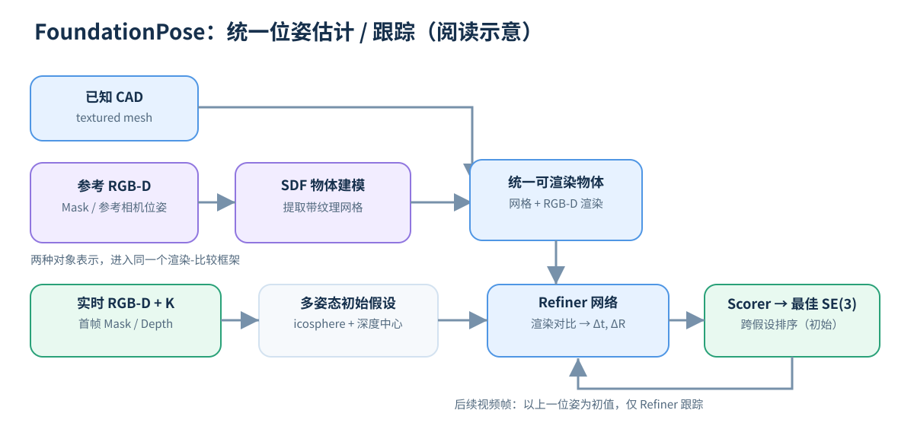

# FoundationPose: Unified 6D Pose Estimation and Tracking of Novel Objects

**作者**：Bowen Wen, Wei Yang, Jan Kautz, Stan Birchfield  
**发表**：CVPR 2024（Highlight），17868–17879；论文 DOI：10.1109/CVPR52733.2024.01692  
**arXiv**：[2312.08344](https://arxiv.org/abs/2312.08344)，v2（2024-03-26）  
**项目**：[NVlabs/FoundationPose](https://github.com/NVlabs/FoundationPose) · [作者主页](https://nvlabs.github.io/FoundationPose/)  
**论文 PDF（外部链接）**：[arXiv v2](https://arxiv.org/pdf/2312.08344v2) · [CVF CVPR 2024](https://openaccess.thecvf.com/content/CVPR2024/papers/Wen_FoundationPose_Unified_6D_Pose_Estimation_and_Tracking_of_Novel_Objects_CVPR_2024_paper.pdf)

> 一句话：用 **RGB-D 的渲染-比较**，先多假设初始化，再迭代细化和排序；后续直接将同一细化器用于逐帧跟踪。提供 CAD 的 model-based 和参考视角重建的 model-free 共用位姿网络，**不需要新对象的位姿网络微调**。

## RTX 5090 × Isaac Sim 仿真实验复现任务书

- [完整 Codex 执行提示词（2026-11-19）](notes/reproduction-rtx5090-isaacsim.md)：单机 5090，双环境隔离，Isaac Sim 6.2 合成 RGB-D、FoundationPose model-based register/track、多场景遮挡/噪声实验、定量报告，Franka 腕部相机作为可选扩展。此任务书是开发计划，不代表任何本地实验已运行。

## 2026-11-19 研究现状与社区评价

- [6D 位姿估计为何仍在发展、FoundationPose 缺陷、社区记录与改进路线](notes/explainer.zh-CN.md#review-2026-11-19)：包括 2026 新官方推理库、后续论文、可靠性/遮挡恢复方案与公平实验设计。

## 阅读入口

- [详细中文精读、源码核对与复现方案](notes/explainer.zh-CN.md)
- [交流日志](notes/dialogue.md)
- [论文原文](https://arxiv.org/html/2312.08344)

## 先看三个使用条件

1. **不是 RGB-only**：需 RGB、有效 Depth、相机内参 K；初始化时需要目标的 Mask，项目默认示例以首帧已知掩码开始。
2. **不是无需模型的一步到位**：model-based 需有尺度正确的 textured mesh；model-free 需带 RGB-D、掩码、相机位姿的参考图像并进行物体独立的 SDF/神经场重建。
3. **不是机械臂规划器或主动视角选择方法**：主要输出物体相对相机的 6D 位姿，腕部相机上需另行处理手眼变换、机器人运动和丢失重定位。

## 源码入口（main 分支，核对日期 2026-11-17）

- [run_demo.py](https://github.com/NVlabs/FoundationPose/blob/main/run_demo.py)：model-based 第 1 帧 register，后续 track_one。
- [estimater.py](https://github.com/NVlabs/FoundationPose/blob/main/estimater.py)：FoundationPose 类，旋转候选、深度初值、细化、评分、跟踪。
- [predict_pose_refine.py](https://github.com/NVlabs/FoundationPose/blob/main/learning/training/predict_pose_refine.py)：渲染-比较、网络预测 Δt 和 ΔR。
- [predict_score.py](https://github.com/NVlabs/FoundationPose/blob/main/learning/training/predict_score.py)：候选位姿排序评分。
- [bundlesdf/run_nerf.py](https://github.com/NVlabs/FoundationPose/blob/main/bundlesdf/run_nerf.py)：model-free 参考视角重建并导出 mesh。
- [readme.md](https://github.com/NVlabs/FoundationPose/blob/main/readme.md)：预训练权重、数据与部署入口。
- [Isaac ROS Pose Estimation](https://nvidia-isaac-ros.github.io/repositories_and_packages/isaac_ros_pose_estimation/index.html)：机器人/ROS 2 的工程部署分支。

## 版权与归档策略

- **原文 PDF**：目前只保留可访问的官方 PDF 链接，**本目录尚未提交 paper.pdf**，因此机器索引标记为 link-only；请勿将不存在的本地 PDF 误认为已归档。
- **代码**：NVIDIA Source Code License，限制为非商业研究或评估使用；不得误称 MIT/Apache。
- 本笔记为独立中文研究解读，图示为自绘示意；不是作者的原图或项目实测结果。
