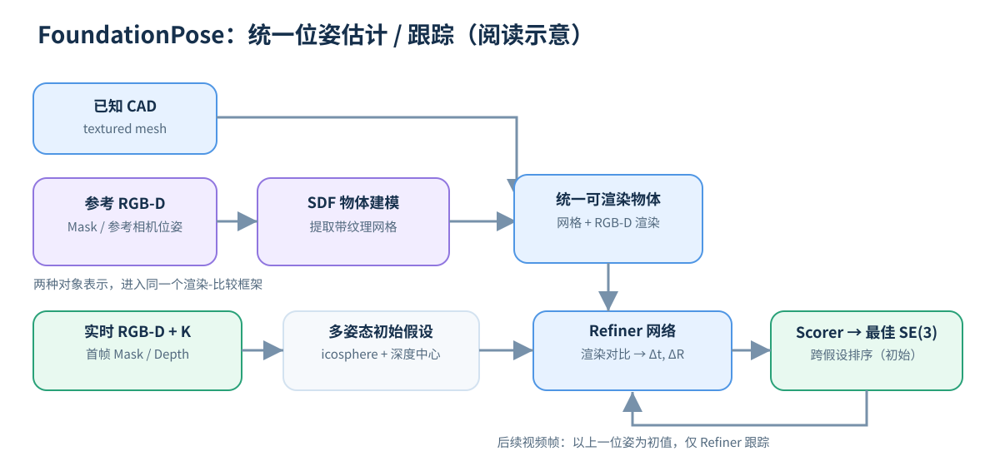

# FoundationPose 论文与源码精读（2026-11-17）

**论文**：Bowen Wen, Wei Yang, Jan Kautz, Stan Birchfield, *FoundationPose: Unified 6D Pose Estimation and Tracking of Novel Objects*, CVPR 2024 Highlight，pp.17868–17879。  
**资料**：[CVF 论文 PDF](https://openaccess.thecvf.com/content/CVPR2024/papers/Wen_FoundationPose_Unified_6D_Pose_Estimation_and_Tracking_of_Novel_Objects_CVPR_2024_paper.pdf) · [arXiv HTML](https://arxiv.org/html/2312.08344) · [官方 GitHub](https://github.com/NVlabs/FoundationPose) · [Isaac ROS 部署](https://nvidia-isaac-ros.github.io/repositories_and_packages/isaac_ros_pose_estimation/index.html)。  
**审查范围**：论文正文和项目 main 分支核心文件；**未进行 CUDA 编译/模型运行/真机测试**。

## 一、定义与边界

目标是输出未知实例刚体相对相机的 6D 位姿，记作物体坐标到相机坐标的 $T_{co}\in SE(3)$。

| 维度 | 第一种 | 第二种 |
| --- | --- | --- |
| 物体表示 | model-based：已有可渲染 CAD mesh | model-free：先用多帧参考 RGB-D 建立对象 3D 表示 |
| 任务 | pose estimation：从未知朝向初始化 | tracking：上一帧姿态为初值，连续更新 |

**novel object / 不微调** 指共享的位姿修正和评分网络不需要针对每个新对象重新训练，不是无需任何先验和预处理。特别是 model-free 仍要依据参考图像、深度、掩码与相机位姿对该物体建立神经隐式场，并导出可渲染网格。

**原版非 RGB-only**：在线输入是 RGB + Depth + 相机内参 K，初次定位还需要目标实例 Mask。代码 demo 首帧 Mask 从数据集读取而非内置自动分割。

## 二、核心算法：Render-and-Compare（§3.2–3.4）

~~~mermaid
flowchart TD
A[已知 CAD 网格] --> D[统一可渲染物体表示]
B[参考 RGB-D/Mask/相机位姿] --> C[SDF + Appearance Neural Field]
C --> D
E[现场 RGB-D/K/首帧 Mask] --> F[深度中心初始化平移 + 多旋转候选]
D --> G[候选位姿渲染 RGB-D]
F --> G
G --> H[渲染图与真实 crop 送入 RefineNet]
H --> I[迭代输出 Δt / ΔR]
I --> J[Scorer 两级排名]
J --> K[最佳 T_cam_obj]
K --> L[后续帧用上一位姿初始化 Refiner]
L --> H
~~~

### 2.1 初始化候选：不是神经网络一步回归任意旋转

论文使用掩码/检测范围对应的深度中值与相机内参获得 3D 平移初值；在以物体为中心的 icosphere 上采样视角，再加入离散平面内旋转以生成候选姿态。源文件 [estimater.py](https://github.com/NVlabs/FoundationPose/blob/main/estimater.py) 中默认 make_rotation_grid(min_n_views=40, inplane_step=60)，并对真正对称的位姿做聚类；最终候选数量**不是固定 240**，视采样结果和对称信息而定。

代码里初始深度需 Mask 与 Depth 的有效交集；如果深度都无效，guess_translation 会返回零向量，有效点少于 4 的 register 甚至可能返回回退姿态。对透明、反光、强遮挡场景这是重要的失效路径。

### 2.2 Refiner：渲染当前姿态，然后学习“差多少”

对每个候选位姿，渲染当前模型应呈现的 RGB-D，同时从真实观测做 pose-conditioned crop。两路特征经过共享 CNN、残差块、patch embedding、Transformer，输出平移与旋转增量：

$$
t^+ = t+\Delta t,\qquad R^+ = \Delta R R.
$$

旋转增量用轴角等局部参数化；训练采用独立的平移误差与旋转误差监督（论文 Eq.10）：

$$
\mathcal L_{\rm refine}=
w_t\|\Delta t-\bar{\Delta t}\|_2+
w_R\|\Delta R-\bar{\Delta R}\|_2.
$$

实际 Python [predict_pose_refine.py](https://github.com/NVlabs/FoundationPose/blob/main/learning/training/predict_pose_refine.py) 包含 nvdiffrast GPU 渲染，Kornia crop 和 RGB+XYZ map 两路输入；不是只比较两张 RGB 图片。

**通俗理解**：网络看到“根据假设渲染的图”与“真实看到的图”有何差别，然后预测如何平移/转动物体模型让两者更一致。每次可重复数轮。

### 2.3 Scorer：为什么要两级跨假设比较？

单独细化每个候选后仍可能有多个局部最优。Pose Ranking Network 首先比较**各候选渲染**和**对应的真实裁剪**，获得每个候选 512D 特征，然后再利用所有候选的 multi-head self-attention 相互比较，输出排序分数。

训练采用 pose-conditioned 的 pair-wise ranking / margin loss，原文 Eq.11：
$$
\mathcal L(i^+,i^-)=\max(S(i^-)-S(i^+)+\alpha,0).
$$

正负候选通过真实 ADD 与旋转差约束筛选。这里的 score 是**相对排序量**，不是经校准的位姿正确概率或 SE(3) 协方差。若用于主动感知，需要另外做质量/不确定性估计。

### 2.4 Tracking 为什么快？

[run_demo.py](https://github.com/NVlabs/FoundationPose/blob/main/run_demo.py) 使用：
- 第一帧：register(K, rgb, depth, ob_mask, iteration=5)，全球初始化 + 多候选 refinement + scorer；
- 后续帧：track_one(rgb, depth, K, iteration=2)，用上帧 pose_last 作为单候选初值，只运行 refinement。

因此速度不同，但视角大跳变、跟踪漂移或长期遮挡时，必须在应用层监测失效并重新调用 register。原 demo **没有完整的自动丢失检测和重新初始化策略**。

## 三、Model-free 的真实含义（§3.2）

参考帧提供 $I_k,D_k,M_k,T_k$，模型分两部分：
- SDF 几何场 $\Omega(x)$：点到表面的带符号距离，零等值面就是物体表面；
- Appearance 场 $\Phi(f_\Omega(x),n,d)$：几何特征、法向、视线方向映射到颜色。

训练有颜色一致性、空域和近表面 SDF 损失、Eikonal 正则：
$$
\mathcal L=w_c\mathcal L_c+w_e\mathcal L_e+w_s\mathcal L_s+w_{eik}\mathcal L_{eik}.
$$

训练后使用 Marching Cubes 提取物体网格，用参考图像纹理化。**推理时主要利用提取出的 mesh 做 GPU 光栅化渲染**，这样能高效并行比较许多候选位姿，而不是每个候选都在线执行 NeRF 体渲染。

[bundlesdf/run_nerf.py](https://github.com/NVlabs/FoundationPose/blob/main/bundlesdf/run_nerf.py) 实际读取 RGB、depth_enhanced、Mask、cam_in_ob、K，进行对象级优化并导出模型。代码 README 提示 model-free 路径有 BundleSDF CUDA 扩展 / 可选 Kaolin 的额外安装成本。

## 四、合成训练与 Isaac Sim（§3.1）

使用 GSO 与 Objaverse/Objaverse-LVIS 大规模 3D 资产。论文研究了通过 LLM（物体语义外观描述）+ TexFusion / diffusion 对对象纹理做多样化增强；之后利用 **NVIDIA Isaac Sim** 的物理模拟、光线追踪、随机化材质、物体大小、姿态、相机及光照渲染 RGB-D 训练数据。

公开数据包含 RGB、Depth、物体真值位姿、相机位姿、Mask 和 2D bbox。优势是通用位姿修正/评分可以在大量从未见过的形状上训练，提高 novel-object 泛化。

**论文和开源权重不完全一致**：官方 [readme.md Notes](https://github.com/NVlabs/FoundationPose/blob/main/readme.md) 明确声明，受基于 LAION 的 Stable Diffusion 相关法律问题限制，**不提供 diffusion texture augmentation 数据以及使用这部分数据训练的权重**，公开模型预计有少量性能降低。

## 五、论文的主要数据与限定条件（§4）

使用 LINEMOD、Occluded-LINEMOD、YCB-Video、T-LESS、YCBInEOAT 五个数据集，涵盖静态估计、遮挡、无纹理、视频及机器人操作场景。指标包括 ADD/ADD-S AUC、ADD-0.1d、BOP Average Recall；这些并非同一指标，**不能直接比较数值高低**。

| 原文位置 | 任务/数据 | 结果 |
| --- | --- | --- |
| Table 1 | YCB-Video model-free，16 reference views，ADD/ADD-S AUC | **91.5 / 97.4** |
| Table 2 | LINEMOD model-free，16 views，ADD-0.1d | 平均 **99.9%** |
| Table 3 | model-based BOP LM-O / T-LESS / YCB-V | AR **78.8 / 83.0 / 88.0**；均值 **83.3** |
| Table 4 | YCBInEOAT Tracking，五类物体，ADD AUC | GT 初始化 **93.09**；估计初始化 **93.22** |
| §4.5 | RTX 3090 + i9-10980XE 耗时 | 首次单对象约 **1.3 s**，后续 Tracking 约 **32 Hz** |

论文 Table 1 的 model-free YCB-Video 测试使用协议中扰动的真值 bbox；实际系统需另加检测/分割，不可把上述数据理解为未提供任何检测先验的端到端性能。

论文 Table 6 消融（YCB-V，16 views）：

| 配置 | ADD AUC | ADD-S AUC |
| --- | ---: | ---: |
| Full | **91.52** | **97.40** |
| w/o LLM texture augmentation | 90.83 | 97.38 |
| w/o transformer | 90.77 | 97.33 |
| w/o hierarchical ranking | 89.05 | 96.67 |
| InfoNCE 替代排序损失 | 89.39 | 97.29 |

**关键观察**：去掉跨候选层次比较使 ADD AUC 下降约 2.47 个百分点，超过本消融中去掉 Transformer 或 LLM 纹理增强的效果；说明排序结构不是可有可无的后处理。

论文 Fig.6：参考图数增加到约 12 张后收益明显趋缓，不是必须采 16 张。Fig.7：训练集大小约到 1M 附近进入收益递减区间。

## 六、开源项目工程核对

| 文件 | 作用 | 注意 |
| --- | --- | --- |
| [run_demo.py](https://github.com/NVlabs/FoundationPose/blob/main/run_demo.py) | model-based 演示；首帧 register，其余 track_one | 默认 Mask 从 demo_data 加载；有 debug_dir 清空操作 |
| [estimater.py](https://github.com/NVlabs/FoundationPose/blob/main/estimater.py) | 模型注册、旋转候选、深度初值、Refiner/Scorer 与跟踪状态 | CUDA 硬依赖；单对象实例 |
| [predict_pose_refine.py](https://github.com/NVlabs/FoundationPose/blob/main/learning/training/predict_pose_refine.py) | 渲染、crop、增量预测 | 网络需要 RGB + 几何信息 |
| [predict_score.py](https://github.com/NVlabs/FoundationPose/blob/main/learning/training/predict_score.py) | 经过细化的候选评分/排序 | 分数不等于置信度 |
| [bundlesdf/run_nerf.py](https://github.com/NVlabs/FoundationPose/blob/main/bundlesdf/run_nerf.py) | model-free 对象建模和 mesh 导出 | 需要 reference poses 等 |
| [environment.yml](https://github.com/NVlabs/FoundationPose/blob/main/environment.yml) | Python 3.11、C++ 工具链 | CUDA/PyTorch3D/NVDiffRast 另安装 |
| [requirements.txt](https://github.com/NVlabs/FoundationPose/blob/main/requirements.txt) | Python 依赖 | 要确保 PyTorch/driver/nvcc 版本匹配 |
| [readme.md](https://github.com/NVlabs/FoundationPose/blob/main/readme.md) | Docker 和 Conda，权重与 demo 数据下载 | 网络权重不随代码库直接附带 |

原版提供 Docker 推荐路径和 Conda 路径。手动安装 CUDA PyTorch、PyTorch3D、nvdiffrast，再执行 build_all_conda.sh 编译 C++ 扩展。Model-free 还可能需要 BundleSDF 自有 CUDA ops。源码 NVIDIA Source Code License **仅限非商业研究和评估**，不得误称 MIT/Apache。

独立的 [Isaac ROS Pose Estimation](https://nvidia-isaac-ros.github.io/repositories_and_packages/isaac_ros_pose_estimation/index.html) 实现提供 ROS 2 + TensorRT 工程化部署，不能与本 Python 仓库看作完全相同的推理栈、版本或测速条件。

## 七、与已归档论文关系

| 维度 | FoundationPose | Active 6D Pose（arxiv:2503.03726） | SDFR 位姿细化 |
| --- | --- | --- | --- |
| 模态 | RGB-D | 仅依赖 RGB 图像估计，使用已知多相机外参 | 深度/表面几何 |
| 对象 | 未知实例但要 CAD 或参考 RGB-D 重建 | 已知 CAD 的无纹理刚体 | 已有初始位姿的几何细化 |
| 主目标 | 全局初始化 + 连续跟踪 | 多视角估计 + Next-Best-View | 精细位姿对齐 |
| 主动选相机 | 原版没有 | 有 | 没有 |
| 适合角色 | 通用估计器 / tracker | 主动观察控制器 | 局部 refinement |

属于任务与输入条件对照，**不是统一 benchmark 的准确率排名**。FoundationPose 的 Scorer 输出相对 rank score，没有 NBV 所需的校准 SE(3) 协方差；若组合，需要额外设计不确定性与候选视角价值函数。

## 八、Isaac Sim / Franka Panda 复现建议（个人研究扩展，不是原文实验）

1. **阶段 A：官方 demo 跑通**。只做 model-based 已知 CAD。下载 README 的 refiner（2023-10-28-18-33-37）、scorer（2024-01-11-20-02-45）、demo_data；先复现实例 Mask + RGB-D。逐帧保存预测 T_cam_obj 和渲染可视化。
2. **阶段 B：Isaac Sim 静态已知物体**。导入 Franka Panda、工业零件 CAD，生成 RGB/Depth/Mask、K、相机外参、真值；先用 GT Mask 隔离分割误差；检验单位（米）、深度尺度、相机光学坐标方向。
3. **阶段 C：真实腕部相机**。D435 深度与彩色配准；手眼标定后：
   $$T_{wo}=T_{wc}T_{co}.$$
   若机器人手腕移动，建议对 tracker 的前一位姿做相机运动补偿：
   $$T_{c_t o}^{prior}=T_{wc_t}^{-1}T_{wc_{t-1}}T_{c_{t-1}o}.$$
   **这是需要自行加入的适配层**，原始 track_one 不接受相机外参；仅依赖上一帧局部细化对大幅相机运动不一定稳定。
4. **阶段 D：工程验证**。测 ADD/ADD-S、平移/旋转误差、失效率、重注册成功率、首帧耗时、持续跟踪 FPS、Mask 偏差、深度缺失、遮挡、快速腕部运动、重新进入视野。
5. **阶段 E：按需要扩展**。考虑 Isaac ROS FoundationPose 真机部署、NBV 主动感知与分割联动。对柔性线缆需要更换任务状态表达，单刚体 SE(3) 无法描述形状。

**注意**：原 demo 可能清空 debug_dir 下已有文件，不要把重要资料目录传进去。此文仅为读码分析，不代表已验证可在用户的 GPU/Ubuntu 环境直接安装。

## 九、Isaac Sim 仿真训练与真实数据评测的区别（2026-11-19 补充）

**结论**：FoundationPose 确实使用 **NVIDIA Isaac Sim** 的物理模拟与 path tracing 生成大规模合成训练数据；但论文 §4 主评测在 LINEMOD、Occluded-LINEMOD、YCB-Video、T-LESS、YCBInEOAT **真实采集数据集**上完成。没有报告机械臂在仿真里在线执行抓取、运动规划、主动移动相机的完整闭环评测。不能把「仿真训练」等同于「机器人仿真验证」。

### 9.1 场景设计（正文 §3.1 + 附录 §5.2）

| 要素 | 论文报告的设置 |
| --- | --- |
| 引擎与画质 | NVIDIA Isaac Sim，重力与碰撞仿真，path tracing |
| 三维素材 | Objaverse（Objaverse-LVIS >40,000 物体、1156 类）+ Google Scanned Objects |
| 物体布置 | 每个场景随机选 70–90 个物体，放在带隐形围墙的平台，模拟自由落体和相互碰撞，待物体速度低于阈值 |
| 物体尺寸 | 随机缩放到 5–30 cm |
| 承载平台 | 尺寸 1–1.5 m |
| 相机 | 每场景 2 个；平台上方半球采样，半径 0.2–3.0 m |
| 光照 | 0–5 灯，位置/尺寸/颜色/强度/色温/曝光随机 |
| 环境 | 662 张 Poly Haven HDR，dome light 方向随机 |
| 材质 | 金属度、反射、对象与平台纹理随机；论文还使用 LLM + diffusion 语义纹理增强 |
| 标注 | RGB、Depth、Mask、相机位姿/内参、物体 6D 真值、2D bbox |
| 数据规模 | 约 **600,000 场景，1,200,000 图像** |

~~~mermaid
flowchart TD
A[Objaverse / GSO] --> B[物体几何/尺寸/纹理随机]
B --> C[Isaac Sim: 70–90 个物体掉落/碰撞至静止]
C --> D[随机 2 相机 + 0–5 灯 + HDR]
D --> E[RGB-D + Mask + 6D 位姿等真值]
E --> F[Refiner/Scorer 训练]
F --> G[真实数据集上的 Sim-to-Real 测试]
~~~

### 9.2 训练方法 vs 实验验证

- Refiner 和 Scorer 先分别训练，再联合微调 5 epochs；附录报告 4 × NVIDIA V100、约一周的合成训练。
- 训练 Refinement 时给 GT 位姿加平移扰动，XYZ 方向量级约 0.02 / 0.02 / 0.05 m，旋转约 20°；渲染与真实 crop 经 160×160 预处理。**这些是训练扰动，非机械臂控制噪声**。
- 论文 Figure 7 在真实 YCB-Video 上评价不同合成训练数据量，约 1M 图像附近增益趋缓。这是使用仿真训练数据后进行真实世界泛化评测，而不是仿真内的机器人运动实验。
- GitHub README 提供合成数据下载和相机参数解析，仓库公开内容中**未发现完整 Isaac Sim 场景生成脚本**；不能据此声称可以一条命令复现 600K 场景。
- README 明确公开权重未使用论文方法中扩散纹理增强的数据，性能可能略有差异，论文结果与开源版本不可无条件视为完全相同。

### 9.3 Isaac Sim 最小复现思路（研究建议，非论文已完成实验）

先用单个已知 CAD 的静态刚体构造 RGB/Depth/GT Mask/K/GT pose，复现 model-based 的初始化与逐帧 tracking；在此基础上逐步增加多物体遮挡、深度缺失、腕相机运动、坐标转换与失效后的重新注册。真正闭环抓取需要机械臂运动规划和控制模块，属于新的验证工作。

**一手来源**：[原文 §3.1、§4、附录 §5.2](https://arxiv.org/html/2312.08344)；[NVlabs 官方 readme.md](https://github.com/NVlabs/FoundationPose/blob/main/readme.md)。

---

## 核心总结

1. FoundationPose 的主体是可迁移的 **render-and-compare：多姿态初始化 → learned refiner → hierarchical scorer**；
2. 通过先对 novel 物体构建 CAD 或 neural SDF mesh，统一了 model-based 与 model-free 的后端；
3. 对机器人尤其有价值的是 **不用对象级 pose 网络微调的 RGB-D 6D pose 初始化 + 约 32Hz 论文条件下的单假设 tracking**，但深度、Mask、初始模型、相机运动与失效恢复仍是重要依赖。

**素材来源**：CVPR 2024 论文 §3–4，官方 GitHub main 的 readme.md、run_demo.py、estimater.py、predict_pose_refine.py、predict_score.py、bundlesdf/run_nerf.py；图示为自绘，并非论文实验原图。

## 十、2026-11-19 深度调研：研究现状、社区评价与改进方向

**调研日期**：2026-11-19。**证据范围**：原论文、官方源码、后续论文、BOP 官方基准、GitHub Issues/PR 与 NVIDIA 官方部署资料。下文方案属于个人分析与建议，未在用户 RTX 5090 或机器人上实测。社区问题采用目的性抽样，不代表全部用户的故障比例。

**核心判断**：FoundationPose 降低了把通用位姿能力迁移到新刚体的成本，适合作为强视觉基线。真实机器人还需要目标发现、可靠性判断、遮挡恢复、相机运动处理和任务精度保障。后续研究正在减少输入先验、扩大场景范围，并提高系统连续运行的可靠性。

### 10.1 为什么高 Star 的成熟项目没有终结课题？

本轮查询原仓库约 3.7k stars。预印本发布于 2023-12-13，会议版本为 CVPR 2024。Star 反映关注和使用意愿，不能说明所有任务条件均已解决，也不能替代论文数量或产业部署的统计。[^r19-abs] [^r19-repo]

“6D 位姿估计”包含多条独立的问题轴：

| 问题轴 | 输入较充分时 | 更开放的条件 |
| --- | --- | --- |
| 物体知识 | 训练时见过同一物体 | 未见实例、未见类别 |
| 几何准备 | 精确且有真实尺度的 CAD | 不完整扫描、参考视频、单张参考图 |
| 目标发现 | 已知身份和位置/掩码 | 自行判断是否存在、有几个 |
| 观测 | 清晰 RGB-D、稳定可见 | 深度空洞、反光、运动模糊、相互遮挡 |
| 时间 | 单帧定位、相邻帧小运动 | 长时跟踪、离开视野、恢复、身份保持 |
| 输出 | 一个看起来正确的位姿 | 位姿、可靠性、失效状态与控制接口 |
| 验收 | 平均几何误差 | 抓取/插接成功率、尾部误差和恢复成本 |

上表是分析框架，各列不能混成一个排行榜。已知 CAD 与未知形状、RGB-only 与 RGB-D、首帧注册与后续跟踪、真值掩码与完整自动管线，需要分别比较。

BOP 的演变提供了直接证据：2024 年增加不预告图像中目标身份的 6D detection 与 model-free onboarding；2025 年又加入工业堆叠和多视角设定。BOP2024 报告还指出，未见物体的 2D 检测仍会成为整条 6D 管线的主要瓶颈。[^r19-bop24] [^r19-bop25]

**信息限制仍然存在。**完全无纹理且轴对称的圆柱，可能没有可用于确定绕轴角度的观测证据；完全遮挡期间，独立运动的目标没有新的视觉测量。算法应保留等价解或扩大不确定性。只有新视角、纹理、接触等确实带来区分信息时，歧义才可能解除。

**机器人任务需要更细的评价。**作为纯几何算例，距离旋转中心 10 cm 的关键点，在 2° 角误差下偏移约为 100 mm × sin(2°) ≈ 3.5 mm。一些抓取可能容忍，较小间隙的插接则可能无法容忍；具体需要取决于任务公差和控制方案。

### 10.2 之前研究的不足

以下是方法族的常见约束，并非每种方法都存在全部问题。

| 路线 | 解决思路 | 常见代价或失效来源 |
| --- | --- | --- |
| 特征匹配、几何配准、ICP | 建立图像/点云与模型对应，再求刚体变换 | 弱纹理、重复几何和遮挡影响对应；局部配准依赖初值 |
| 实例级学习 | 为指定物体学习关键点、坐标或回归位姿 | 新物体可能带来重新准备数据和训练的成本 |
| 类别级，如 NOCS | 在类别内共享规范坐标 | 能泛化到类别内新实例，但仍依赖类别范围和规范定义[^r19-nocs] |
| 参考图/SfM，如 OnePose/OnePose++ | 从参考图重建对象并进行 2D–3D 匹配 | 参考采集、重建仍有成本；OnePose++ 已专门改进低纹理问题，不能一概说这类方法无法处理低纹理[^r19-onepose] |
| 通用 render-and-compare，如 MegaPose | 渲染假设、与观测比较，跨对象学习修正 | 仍需对象表示和目标区域，多个候选带来计算开销[^r19-megapose] |

**历史定位**：MegaPose 在 FoundationPose 之前已经展示“给 CAD 和目标区域，对新物体无需重训”的能力。FoundationPose 的价值在于统一估计/跟踪、强化泛化与提供可复用实现，不应描述为首次实现新物体泛化。[^r19-megapose] [^r19-project]

### 10.3 FoundationPose 的主要缺口

#### A. 目标发现与对象准备

注册接口需要 RGB、Depth、相机内参和目标实例 mask；跟踪用上一帧位姿继续细化。它是目标位姿模块，完整的物体发现和分割仍需外部流程。[^r19-estimater]

model-free 表示无需预先提供人工 CAD，并不代表没有对象准备。参考 RGB-D、掩码和视角/位姿用于建立可渲染表示，真实系统还要取得这些输入。[^r19-modeling]

模型尺度、深度单位、RGB-D 配准或内参错误，会造成互相矛盾的几何。透明、反光和薄小结构导致的深度缺失值得单独测试，不能假定增加网络规模就能消除。

#### B. 局部跟踪缺少完整的失效与恢复管理

原源码注册时进行多候选细化和排序；track_one 把上一位姿作为单候选送入 refiner，没有内置完整的失跟状态、拒绝输出或自动全局重注册分支。[^r19-estimater]

每帧返回矩阵只说明程序仍在执行。大幅移动、长时遮挡或重新出现后，上一解可能不在局部细化的有效范围内。应用层可以再调用 register，但触发时机、恢复确认、旧时间戳结果的处理需要另行设计。

原作者报告过严重遮挡、无纹理和边缘线索不足组合下的失败；这不表示方法无法处理任何遮挡或对称物体。[^r19-paper]

#### C. 相对评分不等于可靠性

Issue #233 中作者明确说明 scorer 的绝对值没有所期待的意义，只用于候选间比较。最高分表达“这组候选中更好”，不能直接表达“有 95% 概率正确”。如果所有候选都错，也会有最高分。[^r19-i233]

这影响失跟检测、主动观察和机器人动作放行。排序分数与校准后的误差概率、置信区间或协方差，应分别处理。

#### D. 模型错误和姿态错误会混淆

模型缺面、背面来自生成、尺度偏差或纹理不同，都可造成渲染和实拍不一致。继续修正位姿可能用错误姿态去补偿错误模型。

UA-Pose 针对不完整参考引入可见区域不确定性，并展示 FoundationPose 选择模块偏爱错误候选的个例。作者将完整训练模型与不完整/生成模型之间的分布差异作为可能解释；这并非已证实的唯一原因。[^r19-uapose]

#### E. 腕相机、多相机和机器人约束

输出是物体相对相机的变换，因此可以使用移动/腕部相机。原始跟踪接口没有显式输入机械臂运动、相机外参和接触状态。腕相机运动、夹爪遮挡、手眼标定与时间戳误差，会增加部署难度。

可考虑运动学预测和跨相机一致性；不能据此宣称原方法仅适用固定相机。多目标也可以分别估计，只是身份、调度、共享计算和物理一致性需要系统处理。[^r19-estimater]

#### F. 速度问题必须区分年份、实现与阶段

原论文在 i9-10980XE + RTX 3090 上报告约 1.3 s/物体的完整估计和约 32 Hz 跟踪。这不是 5090 或新运行时的性能上限。[^r19-paper]

2026-09-22，NVIDIA 宣布新的 FoundationPose Inference Library。当前实现提供 C++/TensorRT、GPU 渲染、Python/C API、多对象与 Blackwell 支持。README 的厂商自报数据，在 RTX PRO 6000 Blackwell、FP16、BOP YCB-V 条件下为注册约 148.37 ms/目标、跟踪约 2.01 ms/目标。硬件和协议不同，不能计算成算法纯加速倍数，也不能当作 5090 全链路保证。[^r19-blog] [^r19-runtime]

**新运行时仍要检查接口含义**：c_api.h 明确写明 track 的 score 固定返回 1。这不能解释为跟踪正确率 100%，也不能由“提供 confidence 字段”推出已解决可靠性。[^r19-capi]

#### G. 推理与完整训练的复现成本不同

官方 README 说明公开权重未使用论文中的 diffusion texture augmentation 数据，预期会有少量性能差异。仓库有权重、数据、网络定义和对象建模内容，但本轮未找到完整的 refiner/scorer 一键训练流程；Issue #172 仍请求训练代码。改网络时要把重建训练流程的成本计入。[^r19-repo] [^r19-i172]

### 10.4 社区评价：具体记录

| 记录及本次状态 | 一手反馈/作者回应 | 支持的结论 |
| --- | --- | --- |
| #233，2024-09-26，Closed | 手遮挡时 score 上升，但视觉跟踪仍较好；作者解释绝对值无所期待的意义 | 排序不等于置信度；关闭 issue 不表示新增了模块[^r19-i233] |
| #136，2024-05-24，Open | 用户问如何识别失跟；后续尝试阈值，反馈分数波动和反复注册降帧 | 识别、恢复与实时预算存在实际权衡[^r19-i136] |
| #119，2024-05-11，Closed | 增加迭代仍漂移；作者查看日志认为帧间运动过大 | 多迭代不能替代运动建模、充分采样与重定位[^r19-i119] |
| #256，2024-11-08，Open | 肯定效果但首帧慢；减候选/迭代后误差变大；作者推荐 Isaac ROS | 有实用价值，也有初始化成本和既有加速路径[^r19-i256] |
| #25，2024-04-04，Closed | 使用对应 .obj 后解决最初问题，再另查快运动/离场 | 一部分问题首先是输入和对象资产适配[^r19-i25] |
| PR #369，2025-07-31，Open | RTX 50 系兼容补丁；用户报告 5090 + WSL + Docker 跑通但另有修补 | 5090 有可行经验；旧环境存在迁移成本[^r19-pr369] |

以上没有随机采样和故障比例统计，不能推出“多数用户都失败”。Star 和成功 demo 同样不能证明长期无故障。

近期正面证据是 NVIDIA 对 Intrinsic Open Machine Tending Solution 集成 FoundationPose 的介绍。这说明仍有应用价值和工程投入，但厂商集成介绍不是独立的工业可靠性认证。[^r19-blog]

### 10.5 后续工作在推进什么？

| 工作 | 推进方向 | 对本项目的启示 |
| --- | --- | --- |
| SAM-6D，CVPR 2024 | CAD + RGB-D 下的实例分割与位姿 | 自动找到目标仍是难题[^r19-sam6d] |
| FoundPose，ECCV 2024 | CAD + 单 RGB，DINOv2 特征，无位姿任务专门训练 | 降低深度/训练依赖是另一目标；不要与 FoundationPose 混名[^r19-foundpose] |
| Any6D，CVPR 2025 | 单 RGB-D anchor 的未知物体位姿与尺度 | 降低对象准备负担，但要面对生成形状误差[^r19-any6d] |
| UA-Pose，CVPR 2025 | 不完整参考的模型不确定性与在线补全 | 简单“加置信度/在线重建”已有先行工作[^r19-uapose] |
| Point2Pose，2026 | 稀疏点初始化、无 CAD、多目标和完整遮挡后恢复 | 可恢复跟踪是独立能力；作者承认部分单目标精度取舍[^r19-point2pose] |
| BOP 2024/2025 | 自动 6D detection、model-free onboarding、工业多视角 | 旧排行榜不涵盖全部应用[^r19-bop24] [^r19-bop25] |

GearTrack 的 2024 arXiv v1 已组合 SAM2、FoundationPose 和 LightGlue 并处理重注册。此处仅引用指定版本的机制，不把它的所有效果声明当作独立验证。“分割 + FoundationPose + 重初始化”本身不够作为新的研究贡献。[^r19-geartrack]

### 10.6 改进方向优先级

> **选题更新（2026-11-19）**：以下为第一轮方向建议；本次进一步发现 STORM、RGBTrack、RRTrack、TEG-Track 等直接先行工作。请结合[第十一节的创新边界与强基线](#recovery-prior-art-2026-11-19)阅读，勿将原版缺项直接视为研究空白。

| 优先级 | 方向 | 具体做法与评价要求 |
| --- | --- | --- |
| P0 | 输入和可复现运行时 | 统一尺度、标定、RGB-D 对齐与时间戳；比较原版和新运行时。这是实验基础 |
| P1 | 可靠性与恢复 | 联合可见几何残差、深度覆盖、运动一致性和候选分歧；预测超任务误差风险；检验错误自信与恢复成本 |
| P1 | 运动学与多视角 | 预测相机运动，按可见性融合固定/腕相机，区分静止/抓持/滑移；同传感器和计算预算比较 |
| P2 | 不完整模型 | 模型可信度、可见区域权重、受控缺面/尺度偏差、异步补全；与 UA-Pose/Any6D 对比 |
| P2 | 主动观察 | 低可靠性时选择能减少歧义的视角；计入动作时间、碰撞约束和任务收益 |
| P3 | 接触辅助精细位姿 | 触觉/力确认抓持与滑移，修正可观测自由度；接触建模成本较高，适合第二阶段 |
| P3 | 自适应计算 | 根据风险调候选数、迭代、重定位频率与多目标调度；需比较现有 TensorRT/GPU 实现 |

建议冻结 FoundationPose，先做测量可靠性与恢复。单独换 backbone、加平滑或安装 TensorRT 的价值需要实测，不能默认形成充分的学术创新。

### 10.7 适合当前平台的研究主线

**候选题目**：面向机器人自遮挡与相机运动的可靠 6D 位姿跟踪及恢复。

**可检验问题**：机械臂靠近并遮住目标时，系统能否及时识别观测退化、保持合理预测，并在目标再现后快速恢复可信位姿？相比固定周期重定位，能否在相近计算预算下减少错误持续时间并提高任务成功率？

第一阶段先做视觉与运动学，稳定后再加触觉/力。以下是建议扩展，不是原论文结构：

~~~mermaid
flowchart TD
    A["固定相机与腕相机"] --> C["FoundationPose 视觉测量"]
    B["机器人位姿与时间戳"] --> D["运动预测"]
    C --> E{"观测是否可靠"}
    D --> E
    E -->|"可靠"| F["融合更新位姿"]
    E -->|"退化"| G["降权并保留候选"]
    E -->|"失效"| H["重新检测与全局定位"]
    G --> I["切换视角或主动观察"]
    I --> C
    H --> J{"一致性检查"}
    J -->|"通过"| F
    J -->|"未通过"| H
~~~

#### 运动学的适用条件

约定 $ {}^{A}T_B $ 把 B 坐标变换到 A；W 为世界/机器人基座，C 为相机，E 为末端，O 为刚体。

物体静止在桌面、相机移动时：

$$
{}^{C_t}\hat T_O
=
({}^{W}T_{C_t})^{-1}
{}^{W}T_{C_{t-1}}
{}^{C_{t-1}}T_O.
$$

稳定抓持物体、令 $G={}^E T_O$ 时：

$$
{}^{C_t}\hat T_O
=
({}^{W}T_{C_t})^{-1}
{}^{W}T_{E_t}G.
$$

若相机也固定在末端，理想情况化为：

$$
{}^{C_t}\hat T_O=({}^{E}T_C)^{-1}G.
$$

此时腕相机与物体一起动，相对位姿近似不变，不能再套“桌面静止物体”公式。滑移/释放后 G 应允许变化；夹爪闭合本身不足以证明无滑移。以上是刚体关系推导，不是实测有效性的声明。

#### 可靠性与恢复机制

可靠性可定义为超过任务误差阈值的概率，输入包括可见区域深度残差、分割一致性、有效深度覆盖、运动预测偏差和跨视角/候选分歧。

同一图像产生的残差、分数和位姿不是独立传感器，不能重复计数。候选差距也受候选集影响，需要校准。测试真值不得进入在线可靠性输入。

完全遮挡时明确标记预测状态，不确定性应随时间及运动假设扩大。全局重定位返回旧曝光时刻的结果时，应处理延迟测量，不能直接覆盖当前状态。

#### 公平实验设计

| 组别 | 配置 | 隔离因素 |
| --- | --- | --- |
| A | 原版腕相机跟踪 | 基础对照 |
| B | A + 运动学 + 固定周期重定位 | 基本工程补全 |
| C | B 改为可靠性驱动恢复 | 相近预算下的策略收益 |
| D | 双相机 + 运动学 + 固定融合/恢复 | 同等传感器的强基线 |
| E | D + 可靠性驱动融合/恢复 | 多视角可靠性贡献 |
| F | E + 接触约束 | 单独评价接触阶段 |

在 Isaac Sim 中控制遮挡比例/时长、相机速度、深度缺失、mask 偏差与模型误差，再以真实序列检查差距。场景覆盖桌面静止、稳定抓持、滑移/释放、离场再现。

各组使用相同权重、mesh、分割器和预处理；真实分割与真值分割诊断组分开报告。不同运行时需记录权重、精度和渲染器，避免把后端变化当作策略贡献。

按物体和完整轨迹划分训练/验证/测试；可靠性阈值只在验证集确定；只使用当前及过去信息，避免相邻帧泄漏。

指标包括：

1. 平移/旋转误差、ADD(-S) 或适用 BOP 指标及尾部误差；
2. 错误姿态被当成可靠输出的频率、持续时间、失效发现延迟；
3. 恢复成功率、误恢复次数、注册次数和恢复延迟；
4. 初始化、跟踪、恢复的独立耗时和端到端 p50/p95 延迟；
5. 抓取/插接成功率、任务时间与非预期接触。

若输出概率，再做校准与风险—覆盖率评价。同 CAD/参考/传感器条件优先对照，不同输入先验的方法分组展示。

#### 与柔性线缆的分工

单一刚体 R、t 无法表示整根线缆的变形。可用 FoundationPose 估计插头、连接器、插座和夹具；线缆本体另用中心线、关键点和局部切向；接触/滑移由视觉、触觉、力和运动学共同约束。

### 10.8 证据边界

- 原版仓库核查 HEAD：a1b694b83e633c2cb6115b9063d940a687759392。
- 新运行时核查 HEAD：89dd4cfec75f944b9fca52d9cb282725f1666c12。
- 所有性能数字属于对应来源的指定测试条件，不是本次实测。
- Point2Pose 本轮依据原始摘要与作者项目页，未引用第三方转载的精度排名。
- 研究方案有动机，但新颖性和有效性仍须针对性比较及实验确认。
- 原有内容和此前复现任务书保留；此节为日期化增量更新。

### 本节一手来源

[^r19-abs]: FoundationPose 书目与版本：https://arxiv.org/abs/2312.08344 。
[^r19-paper]: FoundationPose 正文/附录，§4.5、§5.4：https://arxiv.org/html/2312.08344v2 。
[^r19-project]: 作者项目：https://nvlabs.github.io/FoundationPose/ 。
[^r19-repo]: 原 README：https://github.com/NVlabs/FoundationPose/blob/a1b694b83e633c2cb6115b9063d940a687759392/readme.md 。
[^r19-estimater]: 注册与跟踪代码：https://github.com/NVlabs/FoundationPose/blob/a1b694b83e633c2cb6115b9063d940a687759392/estimater.py 。
[^r19-modeling]: 对象建模入口：https://github.com/NVlabs/FoundationPose/blob/a1b694b83e633c2cb6115b9063d940a687759392/bundlesdf/run_nerf.py 。
[^r19-nocs]: NOCS 官方项目：https://geometry.stanford.edu/projects/NOCS_CVPR2019/ 。
[^r19-onepose]: OnePose++ 正式论文页：https://papers.neurips.cc/paper_files/paper/2022/hash/e43f900f571de6c96a70d5724a0fb565-Abstract-Conference.html 。
[^r19-megapose]: MegaPose 官方项目：https://megapose6d.github.io/ 。
[^r19-bop24]: BOP2024 官方报告 v3：https://arxiv.org/html/2504.02812v3 。
[^r19-bop25]: BOP2025 官方说明：https://bop.felk.cvut.cz/challenges/bop-challenge-2025/ 。
[^r19-i233]: score 的作者解释：https://github.com/NVlabs/FoundationPose/issues/233 。
[^r19-i136]: 失跟检测与恢复：https://github.com/NVlabs/FoundationPose/issues/136 。
[^r19-i119]: 跟踪漂移与快运动：https://github.com/NVlabs/FoundationPose/issues/119 。
[^r19-i256]: 首帧性能与加速回应：https://github.com/NVlabs/FoundationPose/issues/256 。
[^r19-i25]: 输入数据与模型：https://github.com/NVlabs/FoundationPose/issues/25 。
[^r19-i172]: 训练代码请求：https://github.com/NVlabs/FoundationPose/issues/172 。
[^r19-pr369]: RTX50 补丁与5090报告：https://github.com/NVlabs/FoundationPose/pull/369 。
[^r19-runtime]: 新官方推理库：https://github.com/nvidia-isaac/foundation-pose-inference-library/blob/89dd4cfec75f944b9fca52d9cb282725f1666c12/README.md 。
[^r19-capi]: 跟踪 score 的 C API 契约：https://github.com/nvidia-isaac/foundation-pose-inference-library/blob/89dd4cfec75f944b9fca52d9cb282725f1666c12/include/foundation_pose_nvidia/c_api.h 。
[^r19-blog]: NVIDIA 2026-09-22 发布与集成说明：https://blogs.nvidia.com/blog/isaac-ros-5-0-agentic-open-source-robotics/ 。
[^r19-sam6d]: SAM-6D 官方仓库：https://github.com/JiehongLin/SAM-6D 。
[^r19-foundpose]: FoundPose ECCV2024 正式论文：https://www.ecva.net/papers/eccv_2024/papers_ECCV/papers/03742.pdf 。
[^r19-any6d]: Any6D CVPR2025：https://arxiv.org/abs/2503.18673 。
[^r19-uapose]: UA-Pose，§3与附录F：https://arxiv.org/html/2506.07996v1 。
[^r19-point2pose]: Point2Pose 摘要：https://arxiv.org/abs/2604.10415 ；作者项目：https://point2pose.github.io/ 。
[^r19-geartrack]: GearTrack arXiv v1，标题随版本变化：https://arxiv.org/html/2409.19986v1 。

## 十一、2026-11-19 追问：哪些缺陷已有改进，可靠性与失跟恢复还能创新什么？

> **对第十节选题建议的收紧。**“FoundationPose 原版没有某个模块”只能证明工程缺口，不能证明截至 2026 年该方向仍是研究空白。自动恢复、学习式失效验证、自适应阈值、触觉融合、位姿置信区域和任务风险都已有直接先行工作。下面区分论文已完成的内容、证据边界和待验证研究假设。调研截止 2026-11-19；未执行任何 GPU 或机器人实验。

### 11.1 哪些宽泛改进已经有人做？

| 原版缺口或常见想法 | 最接近的先行工作 | 对选题的含义 |
| --- | --- | --- |
| 自动获取 mask、目标再现后重注册 | SuperPose（旧题 GearTrack，2024），STORM（ICML 2026） | 仅接分割器和重新初始化，创新不足 |
| 加 2D tracker、Kalman、状态机 | RGBTrack（IROS 2025）；社区 FoundationPose++ | 已有明确实现；仍可作为工程基线 |
| 学一个失败检测器、时序平滑后触发恢复 | STORM | “增加 verifier”本身已被覆盖 |
| 渲染轮廓验证、可靠记忆、自适应阈值、双模板库恢复 | RRTrack（2026 预印本） | 不能只换模块组合名称 |
| RGB-only 跟踪，减轻深度传感器依赖 | RGBTrack | 真尺度 CAD 与未知尺度分支的条件应分开 |
| 部分模型、不确定性、在线补全 | UA-Pose（CVPR 2025）[^r19b-ua] | 不完整几何与低置信补全已有直接研究 |
| 无 CAD、多目标、完全遮挡后恢复 | Point2Pose（ECCV 2026） | 输入先验不同，不能直接横排精度 |
| FoundationPose 融合触觉/运动学 | V-HOP（RSS 2025）、ViTa-Zero（ICRA 2025）、KineFuse（IROS 2026） | 需与现有多模态方法比较 |
| 根据滑移切换运动估计并融合视觉 | TEG-Track（RA-L 2024；2023 在线） | 滑移检测和切换预测器也已做过 |
| 根据不确定性选视觉/触觉 | HIVE-6D（RA-L 2026） | 模态切换本身不新 |
| 位姿置信区域、将位姿误差转成抓取风险 | Deterministic Object Pose Confidence Region Estimation；残差后验抓取论文 | 不能笼统声称首次做置信度或任务风险 |
| 固定与机器人相机融合、主动选视角 | Naik 等的多视角分布跟踪；Active 6D Pose | 研究需进一步落实到动态交互和恢复代价 |

来源见下文对应文献。这里的“已有改进”不代表这些问题在所有对象、传感器和操作任务上已经解决。

### 11.2 “可靠性与失跟恢复”已有直接后续论文

**SuperPose（arXiv:2409.19986v2，2024，预印本）**是第十节 GearTrack 的同一论文后续标题。它结合 SAM2、LightGlue 和 FoundationPose，通过分割位置与位姿投影偏差触发重注册，并保存参考图处理长期目标丢失。因此，SAM2 + mask 一致性 + reinitialize 是已知路线。[^r19b-superpose]

**RGBTrack（arXiv:2506.17119，IROS 2025）**使用 XMem、Kalman 和状态机，发现 mask/中心异常后在预测附近重新采样姿态、细化和排序。它有 RGB 与 RGB-D 版本；RGB-only 主设定要求真实尺度 CAD，未知尺度恢复另依赖初始深度估计。遮挡恢复仍依赖 2D 跟踪质量。[^r19b-rgbtrack]

**STORM（arXiv:2511.09771v3，ICML 2026）**是“学习失效判断”最直接的近邻。TOM 学习当前裁剪图与成功记忆的兼容性，经平滑和持续异常判定触发重定位；已在独立验证集选择误报受控的阈值。它验证的是兼容性，不是毫米/角度误差的校准概率。作者明确说明 zero-shot 不等于对象身份不相交泛化，机器人任务仍待拓展。[^r19b-storm]

STORM 标题中的 Single Image 指参考入口。官方 FoundationPose adapter 的 register/track 在缺少 depth 或 intrinsics 时会抛出异常，不能据标题将它视为 RGB-only 推理方案。[^r19b-storm-code]

**RRTrack（arXiv:2607.23669，2026 预印本）**已经结合 2D–6D 验证、质量门控记忆、EMA–MAD 阈值、离线渲染与在线观测模板库恢复。它的 Isaac Sim 基准包含 Franka 抓放和遮挡/再现，因此“做 Franka 仿真遮挡实验”本身不新。其真实无人机实验没有精确 6D 真值，定量与实机证据需要区分。[^r19b-rrtrack]

**Point2Pose（arXiv:2604.10415，ECCV 2026）**从单路 RGB-D 与少量初始点出发，利用长时点对应支持多个未知物体的遮挡后恢复，同时在线重建。作者也说明了部分单对象精度与更广免 CAD 能力的取舍。恢复指再次得到观测后找回，不能解释为完全不可见时仍精确观测到位姿。[^r19b-point2pose]

这些论文已覆盖“判定丢失—重新找目标—恢复 pose”的多种实现。若论文只比较原版首帧初始化后持续 track_one 的 FoundationPose，难以说明相对现有恢复方法的贡献。

### 11.3 可靠性要先定义：排序、验证、置信区域与动作风险不同

| 量 | 实际回答的问题 | 不能直接推导的结论 |
| --- | --- | --- |
| 候选排序分数 | 这批假设里哪个更好 | 所有候选都错时，最高分也正确 |
| 外观/轮廓/深度一致性 | 当前可见观测是否支持这个假设 | 被遮挡结构和歧义旋转也正确 |
| 兼容性分类器 | crop 和记忆是否属于合理跟踪状态 | 位姿误差低于任务公差 |
| 位姿分布/置信区域 | 哪些姿态仍可能、区域覆盖频率 | 对每一段动态机器人轨迹均有保证 |
| 动作风险 | 此刻按该估计执行指定动作的风险 | 仅凭一个 pose 分数即可可靠决策 |

例如杯子只露出圆柱侧面时，多个绕轴角度可以解释当前观测；抓杯身与抓把手对此歧义的要求不同。这是说明问题的几何示例，并非某篇论文的实测结果。

已有三项近邻尤其需要避免忽略：

- **On the miscalibration of object 6D pose estimation methods（HEAI @ IROS 2025 workshop）**直接分析 FoundationPose 等方法的分数饱和和误校准，测试 isotonic regression 后仍见局限。它支持继续研究，但不证明所有后处理无效；相关系数本身也不等于概率校准。[^r19b-miscalibration]
- **Deterministic Object Pose Confidence Region Estimation（ICCV 2025）**从共形二维关键点区域传播到位姿区域。其关键点/PnP 与交换性假设需要保留，不能直接当作任意 FoundationPose 动态序列的保证。[^r19b-confidence]
- **Pose accuracy is not grasp reliability: residual pose posteriors improve simulated robotic grasp planning（arXiv:2609.13235v2，2026 预印本）**已冻结 FoundationPose，依据历史残差构造后验并用于抓取选择。证据是实际 LINEMOD 图像加模拟抓取，使用标注可见 mask；后验规划约 10.3 CPU 秒/场景，双视角实验使用标注推导运动。它没有建立真实连续交互中的条件风险保证。[^r19b-posterior]

因此，单纯“给 FP 加置信度”“做 conformal”“学习 pose 残差分布后规划”都过于宽泛。候选差异应落在具体失效事件、因果在线条件、延迟与任务容差上。

### 11.4 多模态和主动恢复也有强近邻

**V-HOP**将 FoundationPose 视觉特征与统一触觉/运动学表示融合，已有跨对象/夹爪评估和实机操作；**ViTa-Zero**利用接触、非穿透和运动学约束在测试时修正视觉位姿。两者分别代表学习融合与物理优化路线。[^r19b-vhop][^r19b-vitazero]

**TEG-Track**更早已显式检测滑移：无滑移时用触觉 marker flow 优化速度，有滑移时由网络预测速度，再联合视觉进行几何/运动学优化。因此，“滑移时撤销固定抓持假设”本身也不是独立创新。其方法与实验没有明确建立失跟后的全局重定位和恢复接受风险评价；这不等于算法绝不可能自然恢复。[^r19b-teg]

**KineFuse**研究结构化手指运动学与触觉融合；量化主要针对 IsaacLab 中已知铅笔状对象，实机演示的证据范围较窄。**HIVE-6D**出版社摘要已明确视觉锚点、触觉修正及 uncertainty-aware routing，并报告实机插接。此次只取得其摘要，不能推断它没有处理滑移或恢复。[^r19b-kinefuse][^r19b-hive]

**ViTaSCOPE**与当前硬件较接近：Franka、双 GelSlim 和固定 D435，联合估计手内姿态与外部接触；作者明确把夹爪内滑移与训练时未知几何列为局限。但一篇论文的局限不能当作整个领域的空白。[^r19b-vitascope]

**Active 6D Pose**已有不确定性驱动的下一视角选择；**Multi-view object pose distribution tracking for pre-grasp planning on mobile robots**已有外部/机器人相机融合、坏视角排除和风险相关抓取决策。后者的真实数据与数字孪生动作验证需分开，不能误称真机闭环抓取已验证。[^r19b-active][^r19b-multiview]

此外，**Robust Pose Estimation through Failure Explanation and Mitigation（ICRA 2026 workshop extended abstract）**已研究检测错误、归因和针对性恢复。因此“按失败原因选恢复”同样需要限定具体新机制。[^r19b-mitigation]

### 11.5 适合当前平台的三个候选切口

以下是基于已核实能力边界提出的**研究假设**，尚未得到新颖性或性能验证。优先固定刚体、已知 CAD、视觉后端，再检验增量；无需一开始兼做对象重建、光学触觉仿真和大模型重训。

#### A. 优先：面向任务容差的连续恢复判定

明确预测事件：

\[
r_t=P(e_{\mathrm{task}}(\hat T_t,T_t)>\epsilon_{\mathrm{task}}\mid h_{\leq t}),
\]

其中历史仅包含当前及过去可获取的信息。也可研究短时间窗内误差持续超标的风险，但需要单独定义标签、动作和预测时间范围。

重点样例是“mask 仍正确、目标身份仍正确，但旋转已偏到足以使操作失败”。增加纯外观匹配可能检测不到这种错误；应研究几何、跨视角和接触证据如何减少错误自信。

**与现有工作的区别需要证明：**兼容性验证与真正的 6D 任务公差分开；分布漂移/对象切换后的风险是否仍可用；允许拒绝输出时，是否以相同任务完成率降低错误执行。残差后验论文已处理任务风险，所以优势需落在因果在线、动态接触和实际时延上。

**主要指标：**风险—覆盖率、错误接受率、错误持续时间、发现延迟、任务成功率。只降低错误率却长期拒绝动作的系统不算解决问题。逐帧共形的假设不能直接搬到相关轨迹，先报告经验结果与独立事件/轨迹区间。

#### B. 视觉与触觉运动估计同时退化后的恢复确认

将接触模式转换作为受控失效场景：视觉遮挡同时发生触觉滑移估计失准或接触信息不足，待重新获得观测后，检验系统能否避免把错误对齐当作成功恢复。运动学模式切换是基础组件，已有 TEG-Track 等先行工作。在稳定抓持时可预测：

\[
{}^W\hat T_{O,t}={}^W T_{G,t}\,{}^G\hat T_{O,t-1}.
\]

这里的物体—夹爪变换必须带不确定性。发生滑移后若仍强制固定该变换，系统可能给出平滑但错误的姿态。

候选机制包括接触条件化的过程噪声、运动学约束松弛、多姿态假设，以及重现后的视觉/触觉联合确认。腕力可提供事件信息，但不自动唯一确定 6D；两指局部触觉也可能不可观测。

**新颖性不能仅靠滑移检测或模态切换：**须对照 TEG-Track、V-HOP、ViTa-Zero，并核对 HIVE-6D 全文；需要检验相对现有触觉跟踪方法，是否更好地处理“遮挡、滑移和错姿态再捕获”这一连续事件，尤其降低错误恢复而保持可用率。

#### C. 限制时间与动作预算的恢复选择

恢复动作可包括等待下一帧、切换可用相机、增加局部假设、全局重注册或短程观察动作。研究价值在于根据接触模式、任务公差和代价选择动作，而不是每次异常都执行昂贵搜索。

需要显式处理异步重定位返回旧时间戳 pose 的情况；不能将旧位姿当成当前测量。若用腕相机主动改变观察，物体与相机一起运动时可能不能增加有效相对视角，应检查可达性和对象运动。

**与近邻区分：**Active 6D 已做视角信息增益，故应评价恢复收益、动作风险、额外时间和计算预算；与固定周期重注册/固定观察动作做相同预算比较。该路线工程范围较大，适合作为 A/B 成立后的扩展。

### 11.6 先做一个能否立题的小实验

目标：检验已有方法是否会在**看似跟住、实际已不能执行任务**时持续输出可信结果。

1. 选取具有方向性操作要求、又有局部近似对称外观的已知刚体，如带键连接件；增加普通非对称物体作为对照。
2. 采集无滑移遮挡、无遮挡滑移、遮挡中滑移、再现后错误姿态对齐等完整事件；先在 Isaac Sim 精确控制，再验证真实序列。
3. 同步固定/腕相机、关节、触觉和力数据；先建立独立真值。可使用不向算法提供的测量装置，不能用待评估 FP 输出当真值。
4. 原始 FP 之外，至少加入固定周期重注册、RGBTrack 或 STORM 及同输入的几何阈值基线；多模态实验加入可复现的 TEG-Track、V-HOP/ViTa-Zero 或明确标注的适配实现。
5. 先检查现有方法是否存在稳定复现的漏报或错误恢复，再设计新网络。若强基线已能可靠解决目标事件，应改动问题范围或评价要求，而非只继续叠模块。

#### 公平性与验收

| 项目 | 要求 |
| --- | --- |
| 输入条件 | 单相机与双相机、视觉与触觉、真值 mask 与预测 mask 分组；同组保持初值、模型和传感器一致 |
| 运行条件 | 固定后端和精度，分别统计初始化、跟踪与恢复；记录端到端 p50/p95 延迟 |
| 数据划分 | 按物体/完整轨迹/事件划分，避免相邻帧随机拆分；阈值在验证集确定 |
| 时间因果 | 在线算法只看当前和过去；不得以真值告知何时重初始化 |
| 恢复计时 | 分别记失效发现时间、重新获得有效观测后的恢复时间和完整停机时间 |
| 正确性 | 平移/旋转误差与适当对称度量；方向敏感任务另定义任务坐标误差 |
| 可靠性 | 错误接受与错误恢复、漏报、误报、恢复后连续正确时长、拒绝/停机比例 |
| 任务价值 | 插接/抓放成功、总耗时、额外动作和计算；不能只报告平均 ADD |
| 统计 | 按独立事件或轨迹给置信区间；避免把强相关帧当作大量独立样本 |
| 算力安排 | 单卡先录制再重放以控制数据；另做在线闭环验证，量化仿真与推理争用 |

多模态优势必须与同模态基线比较，不能把新传感器的信息增益全部归于网络。模拟二值接触/接触几何也不能直接称为已完成 Xense 光学传感器仿真。

### 11.7 阅读和复现顺序

1. **STORM → RGBTrack → RRTrack**：覆盖学习验证、实用状态机、几何与记忆恢复。
2. **误校准 workshop → Deterministic Confidence Region → 残差后验抓取**：确定“可靠”究竟指哪个可检验事件。
3. **TEG-Track → V-HOP → ViTa-Zero → ViTaSCOPE/HIVE-6D**：再决定触觉与接触模式路线。
4. **Point2Pose**：若目标转向无 CAD、多物体和在线重建，优先读。

截至本次核查，RRTrack README 明示源码、数据与评测脚本尚待发布，不能直接计划为开箱运行基线；UA-Pose 官方仓库也仍待代码发布。STORM、RGBTrack、V-HOP、Point2Pose已有代码入口，但发布不等于已在当前设备验证。FoundationPose++ 作者明确说明没有论文，宜作为社区工程基线。[^r19b-rr-code][^r19b-ua-code][^r19b-fpplus]

**推荐决策：**先验证 A 的错误模式，再引入 B；C 作为后续扩展。与其笼统承诺“提升鲁棒性”，更可检验的目标是：在相同输入和预算下，减少接触/遮挡转换中的错误自信和错误恢复，并提高指定操作的有效完成率。

### 本节一手来源与核查范围

[^r19b-superpose]: SuperPose v2（同 ID 的 v1 题为 GearTrack）：https://arxiv.org/html/2409.19986v2 。
[^r19b-rgbtrack]: RGBTrack 正文：https://arxiv.org/html/2506.17119v1 ；代码：https://github.com/GreatenAnoymous/RGBTrack 。
[^r19b-storm]: STORM v3 正文，§3.2、§6、Appendix H：https://arxiv.org/html/2511.09771v3 ；正式 ICML 条目：https://proceedings.mlr.press/v306/deng26a.html 。
[^r19b-storm-code]: STORM 官方适配器：https://github.com/YuDeng321/STORM/blob/main/storm/adapters.py ，2026-11-19 读取的 blob SHA 为 8e8a5d0b82e2ba4d1d4189a30b93bd430bd0f1e6；本文核对代码接口，未执行运行。
[^r19b-rrtrack]: RRTrack 正文，§III–IV：https://arxiv.org/html/2607.23669v1 。
[^r19b-point2pose]: Point2Pose 原始摘要：https://arxiv.org/abs/2604.10415 ；作者项目与 ECCV 标注：https://point2pose.github.io/ 。此处依据摘要/项目页，不声称完整精读其 PDF。
[^r19b-miscalibration]: Bortolon & Poiesi, On the miscalibration of object 6D pose estimation methods：https://openreview.net/pdf?id=RtYLuxeWR1 ；作者机构记录：https://cris.fbk.eu/handle/11582/370147 。
[^r19b-confidence]: Deterministic Object Pose Confidence Region Estimation：https://arxiv.org/html/2506.22720v1 ；ICCV 条目：https://openaccess.thecvf.com/content/ICCV2025/html/Wang_Deterministic_Object_Pose_Confidence_Region_Estimation_ICCV_2025_paper.html 。
[^r19b-posterior]: Sarowar & Kim, Pose accuracy is not grasp reliability，2026-11-01 v2：https://arxiv.org/html/2609.13235v2 ，特别是 §2、§4 的输入、计算与统计限制。
[^r19b-ua]: UA-Pose：https://arxiv.org/html/2506.07996v1 ；论文针对模型完整性的不确定性不能直接等同任务风险。
[^r19b-vhop]: V-HOP：https://arxiv.org/html/2502.17434v2 ；RSS：https://roboticsproceedings.org/rss21/p037.html ；代码：https://github.com/brown-ivl/v-hop 。
[^r19b-teg]: TEG-Track, Enhancing Generalizable 6D Pose Tracking of an In-Hand Object with Tactile Sensing：https://arxiv.org/html/2210.04026v2 ；正式条目 RA-L 9(2):1106–1113 (2024)，DOI 10.1109/LRA.2023.3337690；代码：https://github.com/leolyliu/TEG-Track ，已发布 ShapeAlign 和 kinematics-only 实现，不能默认已有 FoundationPose 适配。
[^r19b-vitazero]: ViTa-Zero：https://arxiv.org/html/2504.13179v1 ；项目：https://ivl.cs.brown.edu/research/vita-zero.html 。
[^r19b-kinefuse]: KineFuse：https://arxiv.org/html/2607.14842v1 ；作者项目：https://cold-young.github.io/kine-fuse/ 。
[^r19b-hive]: HIVE-6D 出版社摘要：https://ieeexplore.ieee.org/abstract/document/11543317 ，DOI 10.1109/LRA.2026.3699258。仅核查摘要，未获取全文。
[^r19b-vitascope]: ViTaSCOPE：https://arxiv.org/html/2506.12239v1 ，§VI 明确说明未处理夹持内滑移；RSS：https://roboticsproceedings.org/rss21/p054.html 。
[^r19b-active]: Active 6D Pose，IJRR 2026-01-27：https://journals.sagepub.com/doi/10.1177/02783649251411922 ；arXiv:2503.03726。
[^r19b-multiview]: Naik 等，Multi-view object pose distribution tracking for pre-grasp planning on mobile robots：https://www.frontiersin.org/journals/robotics-and-ai/articles/10.3389/frobt.2025.1683931/full ，正式发表 2026-01-14；§3 中明确动作在数字孪生执行。
[^r19b-mitigation]: Schneider 等，Robust Pose Estimation through Failure Explanation and Mitigation，ICRA 2026 workshop extended abstract：https://icra2026-rigorous-perception.github.io/pdf/schneider2026.pdf 。
[^r19b-rr-code]: RRTrack 官方仓库：https://github.com/7kevin24/RRTrack ，2026-11-19 README blob SHA d30598df015c2d195eaf8b7a76eb9141d4356d28。
[^r19b-ua-code]: UA-Pose 官方仓库：https://github.com/minfenli/UA-Pose ，2026-11-19 仍只有 README 和 teaser 资料。
[^r19b-fpplus]: FoundationPose++ 社区仓库：https://github.com/teal024/FoundationPose-plus-plus ，README Citation 节明确暂无论文。
