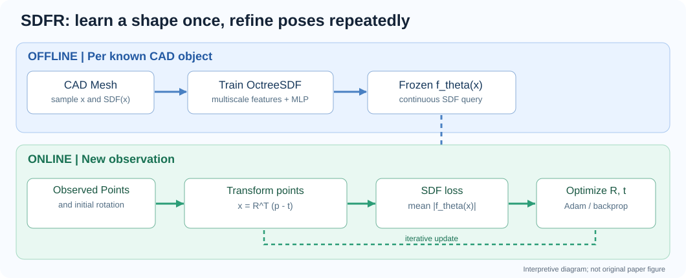

# Fast and Accurate 6-D Object Pose Refinement via Implicit Surface Optimization

**作者**：Bo Pang、Deming Zhai、Jianan Zhen、Long Wang、Xianming Liu  
**期刊**：*IEEE Transactions on Robotics* 41:3129–3142 (2025)  
**DOI**：[10.1109/TRO.2025.3562484](https://doi.org/10.1109/TRO.2025.3562484)  
**IEEE 原文**：[document/10970084](https://ieeexplore.ieee.org/document/10970084)  
**官方代码**：[pangbo1997/SDFR](https://github.com/pangbo1997/SDFR)  
**阅读日期**：2026-11-11

> **一句话**：为已知 CAD 模型离线学习 SDF 隐式表面，在线固定网络及观测点云，通过优化物体旋转/平移使点云到表面的绝对 SDF 值尽可能小，以避免 ICP 的显式最近邻对应。

## 资料入口

- [中文精读、公式解释和代码审查](notes/explainer.zh-CN.md)
- [对话记录与后续补充](notes/dialogue.md)
- [ICP 与 SDF 思路对照图](assets/icp-vs-sdf.svg)
- [哈工大研究报道](https://news.hit.edu.cn/2025/0516/c1510a237967/page.htm)

## 关键判断

1. **本方法是 refinement，不是从零预测位姿**；输入需要已分离的物体观测点云、已知物体 CAD 和一个旋转初始化。
2. **离线训练按物体进行**，不是通用单模型对所有未知物体直接泛化。
3. **不显式建立点对对应**不等于保证全局最优；在线仍是非凸优化。
4. 对几何对称、仅见部分表面、污染严重或深度缺失的物体，应检验可辨识性与模型偏差。
5. 作者实现 `SDFR_adam` 在旋转向量和平移上各执行 100 步 Adam；平移从观测点云中心开始，而非直接使用传入 `init_pose` 的平移。

## PDF 与版权状态

**仓库未存储原始 PDF**：论文发表于 IEEE T-RO，本次尚未核实允许公开仓库再分发其正式版本的许可。根据 [GUIDE](../../../../GUIDE.md) 的版权规则，仅保留 [IEEE 原文链接](https://ieeexplore.ieee.org/document/10970084) 和 DOI；取得明确可再分发的作者版本或许可后再补充 `paper.pdf`。

**笔记依据**：作者公开代码、论文摘要、哈工大公开报道；暂无已验证的完整论文 PDF，因此不把文中未核实的数据或公式冒称为论文原文。
