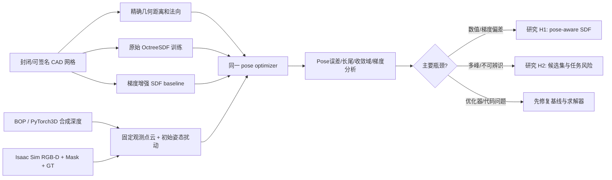

# SDFR 研究与仿真实验实施方案 v1.0（2026-11-19）

> **定位**：研究设计/可执行实验协议，**不是已经运行的仿真或实测结果**。研究问题源自 2026-11-19 ReadPaper/SDFR 讨论。源事实来自作者 [SDFR](https://github.com/pangbo1997/SDFR) 的代码；仿真 API 和硬件要求核对 NVIDIA Isaac Sim 6.2 文档。所有新增的参数和样本量均明确标记为本方案建议，而不是作者论文设定。SDFR 正式 IEEE PDF 未逐页核验，避免将阅读笔记中的二次指标冒充全文事实。

## 0. 核心决策

**目标**：先查明原始 SDFR 在高精度刚体操作中的真正限制，再选择一个能被证明有效且足够区别于先行工作的研究问题。

推荐两条研究线：

- **H1：SDF 表示是否成为位姿优化瓶颈？** 同一观测下，SDF *数值误差* 和 *梯度方向/尺度误差* 是否显著影响 SE(3) 收敛盆地、长尾误差？若是，进一步探索 pose-aware SDF/可控局部更新。
- **H2：即使 SDF 完美，部分可见与几何对称会不会导致本质性的位姿不可辨识？** 当任务只需要局部孔轴/接触区域准确时，能否明确报告不可辨识自由度和动作超容差风险，而不是低 SDF loss 就输出单一确定姿态？

H3 作为后续系统扩展：固定/腕相机、自遮挡和真实深度缺失下的感知-动作预算。**不要在 H1/H2 实验之前就把 H3 做成庞大 Isaac Sim/Franka 控制工程。**

### 为什么不能直接“添加 Eikonal 或鲁棒权重”就宣称创新

SDF 法向/梯度正则、半隐式梯度表示、可见性权重、错误对应降权和多假设位姿等都有先例。代表文献：
[Gradient-SDF, CVPR 2022](https://openaccess.thecvf.com/content/CVPR2022/html/Sommer_Gradient-SDF_A_Semi-Implicit_Surface_Representation_for_3D_Reconstruction_CVPR_2022_paper.html);
[∇-SDF, arXiv:2510.18999](https://arxiv.org/abs/2510.18999);
[DualPP, 2026](https://doi.org/10.1016/j.cad.2026.104113);
[BOP-Distrib, WACV 2026](https://openaccess.thecvf.com/content/WACV2026/html/Meden_BOP-Distrib_Revisiting_6D_Pose_Estimation_Benchmarks_for_Better_Evaluation_under_WACV_2026_paper.html);
[GFLA/VASS](../../../grasping/doi-10.1109-tro.2026.3715994/notes/explainer.zh-CN.md);
[Active 6D Pose](../../../active-perception/arxiv-2503.03726/notes/explainer.zh-CN.md);
[WALDO, WACV 2026](https://openaccess.thecvf.com/content/WACV2026/html/Pakdamansavoji_WALDO_Where_Unseen_Model-based_6D_Pose_Estimation_Meets_Occlusion_WACV_2026_paper.html).

**判断研究新意的对象必须是 H1/H2 的科学问题、独特的推导/约束/评价，而不是已知正则项的组合。**

## 1. 对源码的定点确认（已核验）

- [lib/trainer.py::step_geometry](https://github.com/pangbo1997/SDFR/blob/master/lib/trainer.py)：多尺度 SDF 监督主要是 `sum((pred-gts)**2)`；已核查的主要几何训练循环未显式加 Eikonal/法向监督。**但这不等于领域没有这类方法**。
- [sdfr.py::SDFR_adam](https://github.com/pangbo1997/SDFR/blob/master/sdfr.py)：用 `mean(abs(sdf_value_scene))`，旋转/平移 Adam 步长分别为 0.05/0.003，固定 100 步；旋转经 `so3_log_map/so3_exp_map` 参数化，平移从点云质心初始化；可选 FPS 150 点、尺度参数。
- [prepare_dataset.py](https://github.com/pangbo1997/SDFR/blob/master/prepare_dataset.py)：BOP CAD → 640×480 PyTorch3D 深度渲染 → 点云；对象深度 0.5 m。标准组旋转档位 5–30° / 30–50° / 50–70° / 70–90°，z 平移档位 1–5 / 5–10 / 10–20 / 20–30 cm，xy 另有幅度至 2 cm 的扰动。
- [run_sdfr.py](https://github.com/pangbo1997/SDFR/blob/master/run_sdfr.py)：`diverse` / `corrupt` 也能走运行循环；`if mode in [standard,noise,scale]` **只限定物体名称过滤分支**。**纠正此前研究路线的误判**：不应称脚本完全跳过 diverse/corrupt。另注意 `prepare_dataset.py` 的 `--root-dir` 虽被解析，但 `__main__` 使用硬编码本地 root 变量，定制路径前要修。
- 原始 SDF 训练坐标中的归一化尺度、渲染/输入的 mm→m 转换必须保持严格一致，不能把单位错误误认为算法问题。

## 2. 系统结构与数据流



**核心原则**：CAD SDF 学习/精确查询、点云数据生成、优化器、评价器、Isaac Sim 五部分相互隔离。改一部分时，其余保持不变。

## 3. 阶段 P0：不用 Isaac Sim，复现并检查原始 SDFR

**对象**（建议而非原文固定模型列表）：选 BOP 里的 (a) 不对称模型；(b) 近似轴对称模型；(c) 含孔、薄壁或凹槽的工业模型；阶段 0 三个资产足够。含孔模型要检查 CAD 网格的闭合/水密性。对网格不闭合的模型，不强制给出有物理意义的全局 signed distance；可先另用近表面 unsigned distance 做诊断或挑选水密 CAD。

**同源样本（建议初筛）**：3 物体 × 4 档原始旋转初值 × 每档 25 个独立场景 = **300 个配对测试实例**。保留每个场景的唯一种子、CAD SHA256、真值、相机 K、点云、扰动记录。不同算法处理完全同一组数据。

**基线**：作者 `SDFR_adam`、Point-to-Point ICP、Point-to-Plane ICP、FRICP（能稳定编译时）及一个“精确 CAD 几何查询 + 尽量等价优化器”的**几何对照**。精确 CAD SDF 是表征质量参照，不一定是算法成功率的数学上界：非凸优化/最近面不光滑可影响优化。

**验证门槛**：

- 通过毫米/米单位、CAD 原点、光学相机轴、坐标变换 `T_CO=inv(T_WC)@T_WO`、四元数与 SO(3) 合法性测试。
- 针对已知物体真值姿态，正常深度反投影回三维应落在对应 CAD 表面附近；对干净非对称物体且初始误差较小时，SDFR loss、位姿指标整体应有可测改善；若不符先排查相机、归一化、坐标或训练质量，不凭单个姿态结果做推论。
- 记录原版耗时分解：网络加载、点云预处理、SDF 100 步、总体耗时；每个阶段做多次 GPU warmup 后计时，不能把训练耗时和在线优化混为一谈。

## 4. 阶段 P1：H1 的核心实验——SDF 值与梯度对位姿收敛的作用

### 4.1 先建立“几何质量独立测试集”

对每个 CAD 分四类空间位置采样：
1. **表面点**（几何真值 `d=0`）；
2. **近表面**：沿真值法向 ±0–1mm；
3. **中等表面邻域**：±1–5mm；
4. **较远的误差初值区**：±5–20mm，并加少量包围盒均匀采样点。

所有距离都先转为物理米，并可再除以物体直径得到归一化误差；数值 mm 区间是本方案对小型操作物体的建议，遇到 1m 级大物体需要按直径比例重定。

测量：
- 距离误差 `MAE(|f_theta - d_mesh|)` 与 signed sign consistency；
- 零水平集的 Chamfer / 表面偏离；
- `||grad f_theta||-1`；
- 与最近 CAD 表面法向夹角 `acos(dot(normalized_grad, normal_mesh))`；
- 梯度对 pose 更新方向的相容性：局部 `J = grad f_theta(x)^T · ∂x/∂xi` 和梯度下降步与精确距离场的差异。

**近边/骨架（medial axis）、有多个等距最近面的点存在不可微性**：单独标记/排除方向角比较，不要把“GT 法向不唯一”当作网络错误。

### 4.2 受控 SDF 表征版本

| 代号 | 表征 / 训练损失 | 地位 |
|---|---|---|
| R0 | CAD 精确点到闭合三角网格距离与法向（必要时用可微近似/BVH） | 几何参照；不是公平耗时基线 |
| R1 | 原始 OctreeSDF，原始 SDF 数值 L2 训练 | 论文基线 |
| R2 | R1 + Eikonal `(||∇f||−1)^2` | 已有技术的对照 |
| R3 | R1 + 近表面 CAD 法向方向监督 `1−cos(∇f,n)` | 已有技术的对照 |
| R4（后续） | 根据位姿优化下游误差训练/约束（pose-aware） | **研究候选，不预设成功与新颖性** |

公平性：R1/R2/R3 优先使用相同网络容量、样本/训练步数、训练物体和渲染数据；各版本至少做 3 个 SDF 训练随机种子复验。R4 不能使用最终测试点云 GT 来在线调参。调整正则权重只在验证集，发布完整扫描区间。

**重要**：Eikonal 只约束梯度**模长**，不保证梯度**方向**正确；R2 与 R3 必须分开测试。训练用 CAD 法向时先确认外法线方向一致。

### 4.3 保持同一位姿求解器，先隔离表征因素

固定同一批 SDFR 输入数据（P0 300 实例），在 R0–R3 之间仅切换距离函数；相同优化变量、点数（先固定 150）、初始位姿、迭代 100、停止与尺度处理规则。对于非可微几何查询，用一致的一阶距离/法向替代，明确其近似和 CPU/GPU 开销差异。

随后才做第二层优化器对照：
- O0 作者 100 步 Adam；
- O1 LM/Gauss–Newton（切空间、阻尼、步长线搜索 / trust region），带相同位姿初值；
- O2 早停与固定预算 coarse-to-fine（作为工程基线）；
- O3（扩展）采用下游 pose-aware 训练/不确定区域抑制更新。

分析 **同一 R1+O0 / R2+O0 / R3+O0** 的差异可归因于表征；**R1+O0 / R1+O1** 主要反映求解器差异。避免同时改损失、求解器、点数和初始化。

### 4.4 如何判断是否值得发展 H1

诊断成立的证据：在**数值 SDF MAE 接近**但梯度误差不同的可控设置下，pose 收敛成功率、收敛域与 P95 误差出现稳定、跨几何的差异；并且将坏梯度替换成真值几何梯度会显著恢复 pose 优化。

**可否决标准（作为内部 go/no-go）**：如果 R0 与 R1 在无噪声+可辨识物体的 pose 误差/失败率差距很小，R2/R3 也未带来跨训练种子的一致改进，就不要把“梯度优化”升为论文主线。可以转去 H2 或研究真实数据/优化器问题。不可只因为单个物体提升几个点就宣布创新。

## 5. 阶段 P2：H2——部分可见条件下的位姿可辨识性与任务风险

### 5.1 设计物体 / 视角二重歧义

选择至少三类：
- **非对称工件**：无遮挡时多数 6D 自由度可辨识；
- **轴对称/重复齿轮**：几何本来就有全局对称，不能以普通角度误差判正确；
- **“遮住唯一定位特征”的工件**：比如侧面带小孔的圆柱，孔被遮住时出现与原物体不同的**视角诱导歧义**；遮挡消失后才可辨识。

区分真实**物体几何对称性**和**当前图像/深度观测导致的歧义**，这是 [BOP-Distrib](https://openaccess.thecvf.com/content/WACV2026/html/Meden_BOP-Distrib_Revisiting_6D_Pose_Estimation_Benchmarks_for_Better_Evaluation_under_WACV_2026_paper.html) 已明确提出的评测要求。

### 5.2 场景矩阵与失效归因

| 维度 | 建议设置（不是论文原有参数） |
|---|---|
| 有效可见表面比例 | >80%, 50–80%, 20–50%, <20%（最后单列极端压力测试） |
| 遮挡来源 | 自遮挡 / 桌面物体遮挡 / 夹爪自遮挡（后期 Isaac） |
| 初值旋转偏差 | 0–5°, 5–15°, 15–30°, 30–60°；90° 档作压力测试 |
| 深度噪声 | 理想 0；示例高斯 1/3mm at 0.5m；另做 spatially correlated / hole dropout；**这些不代表 D435 校准噪声** |
| 误分割 | 0 / 5 / 15% 的像素错误 + 边界侵蚀/膨胀，正常方法不得使用真值 mask |
| 视角数量 | 单帧；双帧互补；四帧，已知 K/T；须相同总点数预算对比 |
| 几何模型质量 | R0 精确 CAD、R1 原始 OctreeSDF；进一步引入小幅 CAD 偏差 |

**遮挡率度量**：固定目标位置和相机位姿，渲染“无遮挡体”的目标参考可见像素 A_ref，再加入指定遮挡体得到 A_visible，计算 `1 − A_visible/A_ref`。将“其他物体挡住”与“目标自身不可见背面”分开统计。

### 5.3 可辨识性/不确定性机制的候选（不宣称原创）

- 对当前 pose 估计计算局部线性化 `H≈JᵀWJ` 的奇异值/条件数；旋转和平移单位不同，需要按物体特征长度对平移参数做**无量纲归一化**后比较谱；
- 以多初值旋转/平移优化获取候选模式和最优残差分布；低局部 loss 但多个差别很大的解同时成立时，不能输出“高可信唯一姿态”；
- 引入可见性与渲染深度一致性检验：将已知 CAD 在候选 pose 下投影，只比较实际可用目标像素与正确的可见/遮挡关系；
- 为 “继续 refine / 需要新视角 / 拒绝本次任务执行” 建立预先公布的规则；
- 不将 **BOP 评测 GT、理想分割/物体真值可见率**输入正常算法。这些只用于 oracle upper-reference 和评价；
- 局部 Hessian 不能检测远离当前解的其他模式，应与多候选/对称群集合联合分析。

### 5.4 从 pose 准确率变成“任务相关的误差”

例如为插孔、挂钩或夹具定义局部几何功能位姿 `g(T)`，输入为 CAD 中的孔中心、孔轴、入口面等。
对一个具体任务预先指定：`e_center < 2mm`、`e_axis < 3°` 作为**示例门槛**，不是特定机器人已证实的安全公差；最终应由实际孔径、绳径、夹爪和控制裕量反算。

比较两个状态：全局 ADD(-S) 相近，但关键孔轴误差不同；研究能否基于可见数据拒绝“全局看似正确、实际不满足操作容差”的位姿。注意 [Pose accuracy is not grasp reliability (2026)](https://arxiv.org/abs/2609.13235) 已研究相关风险；如要有创新，必须提供具体的 SE(3)/SDF 可辨识理论和新的任务执行证据。

## 6. 阶段 P3：Isaac Sim 6.2 仿真数据引擎

### 6.1 为什么不用 Isaac Sim 作为第一步

作者原版 Sync 用 PyTorch3D 足以检验表示误差和优化器。Isaac Sim 的增益在于：**复杂遮挡、固定/腕相机、动态环境、RGB/深度/Mask 对齐真值、接触前后**，是 P2 和机器人验证的数据生成器，不替代 SDFR 计算。

设备/版本约束请参阅 [Isaac Sim 6.2 官方硬件要求](https://docs.isaacsim.omniverse.nvidia.com/6.2.0/installation/requirements.html)。该版本 x86_64 最低列 RTX 4080 16GB + 32GB RAM，Ubuntu 22.04/24.04 或 Windows 11。RTX 5090 如确实可用可在兼容驱动环境尝试；确认实际 GPU、驱动、显存及兼容性检查器，**不要假设用户 Mac 可原生运行 Isaac Sim**。SDFR 原始 Python 3.8 依赖应放在独立环境，采用磁盘/IPC 协议通信。

### 6.2 场景层级（先简单后复杂）

- S0 净场：一个 CAD 已知刚体、桌面、**固定相机**；无遮挡，输出理想 Z-depth 和真值姿态；只验证数据契约。
- S1 目标自身可见性：旋转目标、相机角度/距离，构建视角诱导的姿态歧义；无额外物体干扰。
- S2 物体间遮挡：桌面遮挡体/邻接堆叠，固定**相同**目标位姿来实现成对对比；记录 occluder ID。
- S3 机械臂自遮挡：加入 Panda + eye-in-hand 相机 + 手指，改变腕姿/手爪开合；通过 `T_WC=T_WE @ T_EC` 验证外参。记录 robot_occlusion 与 object_occlusion 分量。
- S4 场景变化：目标在接近、抓持、移动后重新观察；包含时间戳、腕运动、手眼和深度同步误差。在 SDFR 静态帧有效前不进行复杂闭环任务。
- S5 有明确功能几何：孔、连接器、钩子、夹具。用场景真值计算端点/孔轴精度与任务通过率；若要做 PhysX 抓取，再另加动力学控制与真实碰撞判定。

### 6.3 相机/数据输出

从 [Isaac Sim 6.2 CameraSensor](https://docs.isaacsim.omniverse.nvidia.com/6.2.0/sensors/isaacsim_sensors_camera.html) 与 [Replicator 实例](https://docs.isaacsim.omniverse.nvidia.com/6.2.0/replicator_tutorials/tutorial_replicator_scene_based_sdg.html) 出发。

首版设置建议：640×480；一个固定相机；距离目标 0.4–0.9m、俯视角约 30–70°（按 CAD 实际大小调），手腕相机二阶段加入。物体 CAD 使用 BOP 或自制**有真实单位**的模型；可先用与原始 SDFR 同一相机内参检查复现，之后再匹配真实 D435 的标定 K。

输出通道：`rgb`、`distance_to_image_plane`（**沿光轴 Z-depth，单位 m**）、`instance_segmentation`、`normals`、可选 `distance_to_camera`；再保存 K、`T_WC`、`T_WO_gt`、物体 id、mesh SHA、随机种子、场景参数。深度相机 distance-to-camera 是 Euclidean range，**不等于 Z-depth**，不允许直接套 pinhole 的 z 反投影公式。物理仿真接触/反光/噪声需明确：**RTX 直接 Z-depth 不是 D435 双目深度误差模型**；真实噪声要通过经验模型/专门传感器模型标定。

推荐协议（见本目录另附 `experiment-config.v1.yaml`）：
```text
data/scene_000001/
  rgb.png
  depth_z.npy          # float32 [H,W], m
  mask_gt.png          # oracle/eval only; NOT normal input
  mask_pred.png        # noisy/predicted mask; method input
  normals_gt.npy       # oracle/eval only
  observation.npz      # P_cam, K, T_WC, T_WO_gt, T_CO_init, object_id
  manifest.json        # seed, camera convention, CAD checksum, versions, corruption
```

定义 `T_AB` 把 B 系三维列向量映射到 A 系，则 `T_CO_gt = inv(T_WC) @ T_WO_gt`，取姿态初始扰动时必须说明左乘/右乘（相机系/对象局部系），不能混淆；所有时间步使用曝光时刻的对应外参。

### 6.4 数据集统计设计（建议预算，不是官方规模）

**Round P0 初筛**：3 CAD × 4 初始旋转档 × 25 场景种子 = 300 组输入（不同算法共享），用于快检查。每个模型 3 个神经 SDF 随机训练种子做稳定性验证；训练/验证/测试场景不共用相同像素/初值随机流。

**Round P1 机制验证**：3 CAD × 4 初值档 × 3 个可见率档 × 30 场景种子 = 1080 组观测；R0–R3 四种表征在相同优化器下配对测试，先采用一组 SDF 权重对照，再在关键结果上重复 3 个训练种子。

**Round P2 场景扩展**：6 CAD × 3 可见率档 × 3 初值档 × 30 场景种子 = 1620 组；另外单独做三个深度噪声档和三组 mask 错误档。为了避免笛卡尔积爆炸，**先每次只变化一个主因素**，再做最多两组交互实验，例如“遮挡×噪声”和“近对称×初始旋转”。

**统计**：以同一场景/种子进行配对比较；成功率报分子/分母与 95% Wilson 区间；连续误差报 median/P90/P95 和按场景 bootstrap 区间；同一 CAD 的不同渲染帧属于相关样本，按对象/场景分层汇总。多种超参只能用验证集选，测试集一次性固定复核；反复查看测试集并调参须另设最终 holdout。

### 6.5 评测指标与图表清单

- 几何表征：SDF 值 MAE，gradient cosine/angle，Eikonal 范数，零等值面 Chamfer、内外符号；
- 位姿：R/t 连续误差、ADD(-S)、BOP VSD/MSSD/MSPD（依据对称/可见性定义）、5cm/5°、1cm/5°、5mm/2°（最后两个为提议的更严格门槛）；
- 收敛盆地：按初值误差分桶的成功率热图，迭代过程 loss/pose 曲线，几何条件数与多模式；
- 鲁棒性：遮挡率/深度误差/误分割-成功率曲线、P95 与失败归因；
- 任务：孔中心误差、孔轴角误差、几何间隙风险、动作拒绝率、真失败漏检率、完成一次正确任务的额外观察成本；
- 性能：SDF 离线训练、在线 FPS 或 P50/P95 ms、GPU VRAM、数据预处理、GPU 同步计时；
- 图示：代表性场景 RGB/Depth/GT Mask/Pred Mask，点云与 CAD 网格对齐、SDF 梯度矢量、优化历史、成功率热图、位姿误差分布。

[官方 BOP 评价协议](https://bop.felk.cvut.cz/tasks/) 提供 VSD、MSSD、MSPD 和阈值等定义；不能将 ADD/ADD-S 与 AR_BOP 当成同一分数。

## 7. 风险、失败归因与避免数据泄漏

按下面类别为每次失败添加人工可复核标签：
- **REP** SDF 值或梯度偏差；
- **OPT** 正确表面/观测仍落入局部最小值；
- **OBS** 自遮挡、对称或可见性缺乏导致多个合理姿态；
- **SEN** 深度错误、分割错误、离群点；
- **CAL** 内外参、时间戳、单位、CAD 原点；
- **PHY**（后期）PhysX 动力学、夹爪碰撞/抓取控制问题。

避免一个失败被错误归入“模型不鲁棒”；当完美 CAD 梯度也不能解决，优先怀疑信息不足、错误输入或初始化问题。

**GT 只允许用于数据生成、离线标注和 Oracle 对照，不允许在常规算法的自适应权重、动作接受、候选排序或下一视角选择中使用 GT**。GT mask / GT pose / GT normals 在同一接口应有明确 eval-only 标记。

## 8. 阶段验收（可停止的研究流程）

| Gate | 要求 | 不通过时处理 |
|---|---|---|
| G0 | SDFR 原版数据/原版算法可重复，坐标与单位测试通过 | 不进入 Isaac；先修复环境/接口 |
| G1 | R0/R1 表征误差与 pose error 可以按场景对齐，并能在独立案例复现 | 不提出新 pose-aware 网络 |
| G2 | 发现跨物体与训练种子一致的梯度-收敛相关性，并通过精确梯度替换做因果对照 | 若无，关闭 H1 转向 H2 |
| G3 | 对已知对称/隐藏关键特征的情景能识别多模态或近零信息方向 | 若无，先验证评价协议/可见性 |
| G4 | Isaac 静态 RGB-D/K/GT/Masks 与 PyTorch3D 对照一致且无单位/光轴混淆 | 不加入运动机器人 |
| G5 | 在真实 BOP/自采 D435 数据及动作容差上获得可统计验证的收益 | 不称已完成 sim-to-real |

成果的**最小封闭实验**是 P0 + P1 的 H1 假设检验，随后根据 G2 决定是否启动 P2/P3；**不需要等待整套 Isaac 机器人完成才能形成可信机制结论**。

## 9. 软件工程布局与复现约定

论文笔记存 ReadPaper；可运行算法/仿真代码建议单独建 `SDFR-Research` 仓库或工作树，不把大模型、数据集与 GPU 运行日志提交到 ReadPaper。

```text
sdfr-research/
  upstream/SDFR/          # 原版代码，固定 commit、只读
  configs/                # baseline.yaml, sdf-gradient.yaml, isaac-camera.yaml
  geometry/               # exact-mesh SDF query, gradient diagnostics
  methods/                # original adapter, regularizer variants, optimizers
  datasets/               # synthetic and Isaac adapters (raw data gitignored)
  sim/                    # Isaac Sim isolated export scripts
  experiments/            # sample generation, sweeps, calibration, evaluation
  tests/                  # coordinates, units, geometry, data schema, no GT leakage
  results/                # compact CSV/Parquet, plots, manifest and failures
  reports/                # protocols, tables, source commits, reproducibility
```

第一版按作者代码环境锁定依赖，不要求原版和 Isaac 使用同一 Python 解释器。单 GPU 的显存压力大时，先顺序进行 Isaac 渲染导出、退出渲染器，再运行 SDFR 评测；待离线两阶段稳定后才考虑共享内存/在线闭环。GPU/CI 资源仅用于必要验收，不做昂贵的云端 CI 仿真。

推荐在实验运行目录保存：Git commit、Python/PyTorch/CUDA/Isaac 版本、GPU/驱动、CAD 文件 SHA256、配置快照、种子表、随机生成器状态和原始错误日志；所有图表可追溯到样本列表。

## 10. 当前状态与下一动作

- **已完成**：基于作者源码与公开文献的实验协议、阶段 Gate 与数据字段设计。
- **尚未完成**：安装、数据下载、训练、Isaac 场景创建、基线对比或任何结果测量。
- **下一动作（建议）**：在可运行 CUDA 的机器上克隆官方 SDFR、使用官方的小数据集做 G0；然后用三个 CAD 生成 P0 的固定种子样本，完成 R0/R1 两组对照后再开发神经训练正则或 Isaac 场景。

### 关键来源

- [SDFR 官方源码](https://github.com/pangbo1997/SDFR)
- [BOP 数据集](https://bop.felk.cvut.cz/datasets/) 和 [BOP 任务及评价](https://bop.felk.cvut.cz/tasks/)
- [Isaac Sim 6.2 要求](https://docs.isaacsim.omniverse.nvidia.com/6.2.0/installation/requirements.html)
- [Isaac Sim 6.2 Camera Sensors](https://docs.isaacsim.omniverse.nvidia.com/6.2.0/sensors/isaacsim_sensors_camera.html)
- [Isaac Sim 6.2 Scene SDG](https://docs.isaacsim.omniverse.nvidia.com/6.2.0/replicator_tutorials/tutorial_replicator_scene_based_sdg.html)
- [Gradient-SDF, CVPR 2022](https://openaccess.thecvf.com/content/CVPR2022/html/Sommer_Gradient-SDF_A_Semi-Implicit_Surface_Representation_for_3D_Reconstruction_CVPR_2022_paper.html)
- [∇-SDF, arXiv:2510.18999](https://arxiv.org/abs/2510.18999)
- [DualPP, CAD 2026](https://doi.org/10.1016/j.cad.2026.104113)
- [BOP-Distrib, WACV 2026](https://openaccess.thecvf.com/content/WACV2026/html/Meden_BOP-Distrib_Revisiting_6D_Pose_Estimation_Benchmarks_for_Better_Evaluation_under_WACV_2026_paper.html)
