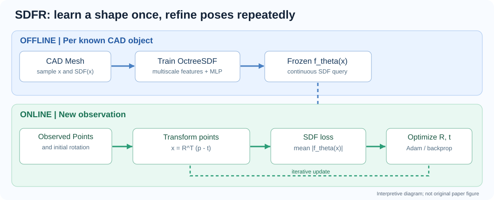
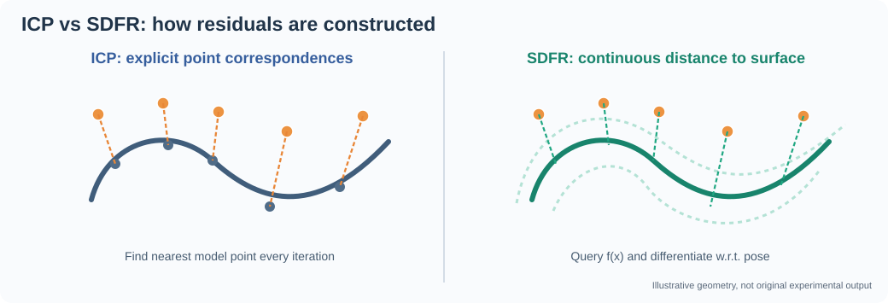

# SDFR 论文精读：隐式 SDF 表面与 6D 位姿细化

> **证据等级说明（2026-11-11）**：正式 IEEE PDF 暂不能直接获取；以下解释根据作者公开代码 `pangbo1997/SDFR`、论文摘要和哈工大 2025-05-19 的报道。文中公式标为“方法的数学化解释”，不是声称逐字转录期刊公式；实验数字目前仅采纳可独立核实的机构报道。

## 1. 定位与问题

6D 位姿细化（refinement）在已知 CAD、观测点云、初始位姿的情况下精化刚体的旋转和平移。SDFR **不负责**目标检测、分割或初始全局位姿估计；作者在实验中可以把它接到 OVE6D、ZebraPose 等先验估计器后面。



## 2. 与 ICP 的根本区别

传统 point-to-point ICP 的典型目标是：
```math
min_{R,t} Σ_i ||Rp_i + t - q_{c(i)}||²
```
其中 `c(i)` 是每次迭代根据最近邻重估的对应点下标；匹配错误容易影响局部优化。

SDFR 把 CAD 的曲面变为连续可查询的函数 `f_θ(x)`：
- 曲面外 `f_θ(x) > 0`
- 曲面上 `f_θ(x) ≈ 0`
- 曲面内 `f_θ(x) < 0`

在线将相机坐标点 `p_i` 转换到 CAD 规范坐标 `x_i = R^T (p_i - t)`（实际代码还包含物体中心化与单位尺度换算），然后最小化：

```math
L(R,t)= (1/N) Σ_i | f_θ(R^T(p_i-t)) |
```

**关键差异**：SDFR 通过固定、已学习的隐式表面提供几何残差，不需每轮为每个观测点显式搜索 CAD 最近邻对应。它并不摆脱局部优化，也不能凭空补足完全缺失的观测。



## 3. 离线训练：CAD → SDF 网络

1. 读取已知物体的 CAD 网格。点 `x` 的真实 SDF `d(x)` 用于监督训练。
2. 对点位置采样，使用带多尺度特征体（`FeatureVolume`）的 `OctreeSDF` 网络进行隐式编码。
3. 网络输出连续 SDF；训练损失用预测值与真实 SDF 值的平方差，训练阶段更新网络权重。
4. 完成训练后保存每个物体的 `.pth`，作为在线的固定几何先验。

代码依据：`lib/models/OctreeSDF.py`、`lib/trainer.py`、`run_sdfr.py:init_SDFR`。训练入口设置 `num_lods=5`、`epochs=40`（具体环境、网格及硬件影响耗时）。哈工大报道给出的离线训练时间为约 4–5 分钟，不能不加条件地视为任何机器上的保证。

## 4. 在线优化：固定网络，只调位姿

1. 从前端得到目标点云和初始旋转；可用最远点采样选少量点。
2. 将点变换到 CAD 坐标系，并查询固定 SDF 网络。
3. 使用 `L=mean(abs(sdf))` 对旋转和平移求梯度。
4. 优化变量持续更新，得到新的刚体位姿（可选尺度参数）。

旋转在代码中采用 `so3_log_map` 转为三维旋转向量，并经 `so3_exp_map` 构建旋转矩阵，避免直接自由更新九个旋转元素破坏 `SO(3)` 约束。

### 代码核验（不能与论文表述混同）

对 `sdfr.py:SDFR_adam` 的直接检查发现：
- 采用两个 Adam 优化器，分别优化旋转向量和物体中心平移；默认 100 轮。
- 旋转初值来自 `init_pose[:3,:3]`；**平移初值使用 `trg_pts.mean(dim=1)`**，并没有直接采用 `init_pose[:3,3]`。
- 典型学习率：旋转 `5e-2`，平移 `3e-3`。尺度优化分支另有参数和优化器。
- 标准数据入口默认允许对点云做 FPS，`K=150`；噪声模式会改变这一行为。
- `SDFR_lm` 是另一个实现入口；不要据此把默认发布的 `SDFR_adam` 说成 LM 求解。

### 梯度直觉

`∂L/∂t` 指示沿哪个方向平移能让更多点接近 `SDF=0` 的等值面；`∂L/∂R` 同理调整空间旋转。自动微分通过 `f_θ` 返回优化所需梯度，网络参数本身在在线阶段保持不变。

## 5. 实验与结论

作者使用合成点云与真实 RGB-D 数据构造对齐实验，涉及 LINEMOD、Occluded LINEMOD、YCB-V、T-LESS，以及噪声、尺度变化、遮挡/破损等设置，并与 ICP 变体比较。官方仓库的 `README.md` 给出 synthetic/sim-real 数据准备、SDFR、FRICP、SymmICP 运行入口。

一个明确可核查的结果：哈工大报道指出，在 **Occluded LINEMOD + OVE6D** 设置下，准确率由 **55.3% 提高至 71.5%**（+16.2 个百分点）。这个数值属于特定估计器与数据集组合，不代表任意机器人实时系统都能得到相同收益。

可靠出处：
- [哈工大新闻网，2025-05-19](https://news.hit.edu.cn/2025/0516/c1510a237967/page.htm)
- [IEEE DOI](https://doi.org/10.1109/TRO.2025.3562484)
- [作者开源实现](https://github.com/pangbo1997/SDFR)

## 6. 方法为什么可能优于 ICP

1. 无需离散的最近邻重匹配，减少错误对应造成的迭代偏差。
2. 多尺度特征网格 + 轻量 MLP 实现快速连续查询及反向传播。
3. 更便于把几何先验融入可微优化，结合位姿与尺度调整。

**谨慎理解“避免局部最优”**：这是作者对实验优势的归纳，而非全局收敛定理。SDF 的几何对称性、局部不平坦、严重错误初值及错误点云，依然能造成不适定或局部最优。

## 7. 主要限制与实践风险

- **对象已知**：每个 CAD 物体需要离线学习；未知物体不能直接依赖已有权重。
- **需要有效点云**：虽然可处理遮挡和部分缺失，透明/反光物体如果深度几乎完全不可用，依然缺乏数据残差。
- **点云污染**：背景、抓手、桌面或其他物体被错误分割成目标时，会被 SDF 损失吸引，未必鲁棒。
- **对称性**：圆柱/齿轮等完全对称对象可能无法唯一恢复全部旋转自由度，SDF 残差无法区分几何等价姿态。
- **模型与现实误差**：实际变形、夹具遮挡、CAD 与实物不一致可能影响优化结果。
- **额外训练与算力**：每个物体的 SDF 训练、CUDA/PyTorch3D 环境和线上梯度更新是工程成本。
- **6D 不是 7D**：代码提供可选尺度优化分支，但这不应被理解为对任意几何形变的建模。

## 8. 与前一篇 Active 6D Pose 论文对比

| 维度 | Active 6D Pose（arXiv:2503.03726） | SDFR（本篇） |
|---|---|---|
| 核心任务 | 多视角 RGB 位姿估计 + 下一视角选择 | 已有位姿的 RGB-D/点云精化 |
| 输入 | 多张 RGB、已知相机位姿、已知 CAD | 观测点云、CAD/SDF、初始旋转或位姿 |
| 位置处理 | 多视角中心重投影 | 点到隐式表面距离的梯度优化 |
| 旋转处理 | 轮廓模板、多峰旋转假设 | SDF 残差优化 `SO(3)` 变量 |
| 主动相机运动 | 有 NBV 策略 | 不负责 NBV |
| 能否组合 | 可提供上游姿态，但需要可靠点云与坐标系转换才能接 SDFR | 可能作为下游精化模块，组合并非论文现成系统 |

## 9. 针对机器人研究的理解

对于已知刚性物体、Franka 机械臂 + RealSense D435 场景，可以先考虑构建简化实验：CAD 文件 → 深度观测/实例掩码 → 姿态扰动 → SDFR / Open3D ICP 同条件对照；测试时明确区分纯合成、真机桌面、遮挡、反光和严重错分割。若用于线缆等柔性体，单一刚体 `SE(3)` 不能描述形变，应将状态从位姿拓展为中心线/节点位移或可变形的隐式表示。

## 10. 下一步可进一步核验

- 在可合法获取期刊 PDF 后逐项核对论文公式、表格、训练细节和优化超参数。
- 复现代码与论文描述是否一致，包括平移初始化、尺度设置、采样、分割误差。
- 对接现有机器人相机坐标系时确认 `T_{cw}` / `T_{wc}` 定义、米/毫米归一化与 CAD 原点。
- 给出与 Point-to-Plane ICP、Generalized ICP、TEASER++ 等的相同初始误差与耗时比较。
