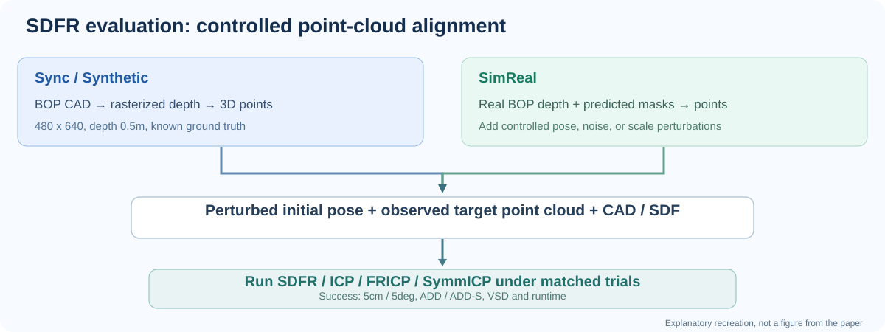

# SDFR 的仿真与半真实实验设计（2026-11-17 增量精读）

> **证据来源**：本页的具体生成参数与运行配置直接核对作者 [SDFR 仓库](https://github.com/pangbo1997/SDFR) 的 `README.md`、`prepare_dataset.py`、`prepare_simreal_dataset.py`、`run_sdfr.py`、`run_sdfr_simreal.py` 与 `eval_metric.py`；正式期刊 PDF 暂未直接逐页审阅。**区分“公开代码事实”和“基于代码的解释”；未经原文核实的表格数值不作为确定结论。**

## 0. 最重要的界定

**有仿真实验，但不是 Isaac Sim / MuJoCo 中的机械臂闭环抓取。** 作者侧重通过 CAD 模型渲染深度图、生成点云，然后人为制造位姿偏差与观测污染，比较 SDFR 对刚体 6D 位姿的恢复效果。三个层次：

1. **Sync / Synthetic**：渲染深度 → 合成观测点云，GT 已知，初值人为扰动。
2. **SimReal**：真实 BOP 深度图与 ZebraPose 预测掩码 → 真实点云，再构造可控的初值扰动、噪声或尺度变化。
3. **真实位姿细化**：使用真实估计器给出的初始位姿，SDFR 作为 downstream refinement；代码生成器具有 `real` 模式，但 `run_sdfr_simreal.py` 的评测调度需检查 `real` 是否纳入。



## 1. Sync 合成组：如何造一条评测数据

源脚本：[prepare_dataset.py](https://github.com/pangbo1997/SDFR/blob/master/prepare_dataset.py)

1. 从 BOP models_eval 下载已知物体 CAD（`lm`、`ycbv`、`tless` 等），必要时把 PLY 转 OBJ，换算单位 mm → m。
2. 基于球面均匀分布近似采样不同物体朝向：`evenly_distributed_rotation(num)`，平移设为 `[0,0,0.5]` m。
3. PyTorch3D `MeshRasterizer` 在 640×480 分辨率下生成 z-buffer 深度图；相机 K 为约 `fx=fy=532.86, cx=318.19, cy=238.89`。
4. `depth_to_pointcloud` 将非零深度像素按相机内参反投影为目标点云（`target/model_j.ply`）；另外从整个 CAD 表面均匀采样 5000 点供源模型使用。
5. 围绕真值位姿构造误差初值 `init_pose`：随机旋转轴、给定范围旋转角、扰动平移，并在错误位姿下生成模型源点云 / 渲染源点云。
6. 保存 `source/`、`target/`、`init_pose/`、`gt_pose/`，在同一批数据上评测 SDFR、ICP、FRICP、SymmICP。

**特别注意**：旋转初始误差按角度范围采样；代码中平移区间 `trans_interval` 只施加到 z 方向，x/y 各取 0~2 cm，随后随机整体变号。所以“1~5 cm / 5~30°”等区间的厘米范围并不直接等于三维平移模长。

## 2. 五种纯合成测试模式（源代码参数）

| mode | 设置 | 每物体实例量/参数 |
|---|---|---|
| `standard` | 四档旋转 / z 平移初值误差 | 每档 150：5–30° / 1–5 cm；30–50° / 5–10 cm；50–70° / 10–20 cm；70–90° / 20–30 cm |
| `noise` | 观测点沿法线平移，并在 bbox 内添加均匀空间离群点 | 每档 200；离群点数量为原点数的 50% 或 100%；旋转 10–70°，z 平移 5–20 cm |
| `scale` | 保持 CAD 不变，将目标点云相对于 GT 平移位置缩放 | 每档 200；scale = [0.5,0.8] 或 [1.2,1.5]；旋转 10–70°，z 平移 5–20 cm |
| `diverse` | 扩大用于测试的 CAD 模型种类 | 每模型 100；旋转 5–70°，z 平移 1–20 cm；遍历下载的 PLY |
| `corrupt` | 深度图区域擦除 + 视线倾斜表面删点 | 每模型 100；旋转 5–70°，z 平移 1–20 cm |

### 噪声实现并非完整随机高斯模型

作者把变量命名为 `gauss_noise`，但实际代码是 `normals * median(KDTree 6-NN distance)`，并没有在这一项显式调用高斯随机数生成器。离群点则按观测 bbox 内均匀采样。报告“纯高斯噪声的标准差”时应避免直接从变量名推断。

### Corrupt 组并非光线追踪的真实镜面反射

`process_occlusion_removal` 在对象深度 bbox 上连续执行 RandomErasing（一次必执行，另外两次概率分别为 0.8 和 0.5，擦除面积比例分别在 0.1~0.15 / 0.1~0.2 / 0.1~0.2）。

`process_reflection_removal` 则将点云法线朝向相机，对法线与指定观测方向夹角超过 70° 的点以约 20% 的概率删点。**因此这是几何层面的观测缺失鲁棒性测试，不是对真实反光材料电磁/光学成像的仿真。**

## 3. SimReal：真实深度点云 + 合成扰动

源脚本：[prepare_simreal_dataset.py](https://github.com/pangbo1997/SDFR/blob/master/prepare_simreal_dataset.py)

准备 BOP 真实测试图像，再依 README 通过 ZebraPose 流程得到 `color/`、`trg_pcds/`、`cam_K/`、`gt_poses/`（和相关 `init_poses/`）。与 Sync 核心区别：**目标观测点云来自真实深度与预测掩码，而不再来自干净的渲染深度**。

- `standard`：旋转 30–90°，z 平移 10–30 cm；对真实点云进行半径离群点过滤（16 邻居，0.05 m）。
- `noise`：旋转 10–70°，z 平移 5–20 cm；对已有真实点云额外加入法线方向扰动与 50%–100% 随机数量离群点。
- `scale`：旋转 10–70°，z 平移 5–20 cm；缩放观测点云为 0.5–0.8 或 1.2–1.5 倍。
- `real` 生成分支：直接使用 `init_poses/` 的真实预测位姿，不再人工构造旋转平移扰动。

**样本数注意**：SimReal 分支实际上遍历 `zebra_dataset` 可用实例 ID；调用里的 `num=150/200` 参数并非严格控制每个模型生成 150/200 张新真实观测。

## 4. 基线与评价指标

基线：经典 ICP，Fast Robust ICP（FRICP）以及 Symmetric-ICP（SymmICP）；可设置是否使用源 CAD 的渲染可见点云参与比较（`--render`）。

源：[eval_metric.py](https://github.com/pangbo1997/SDFR/blob/master/eval_metric.py)。

- **5 cm / 5° 正确率**：`||t_pred-t_gt|| < 0.05m` 且旋转角误差小于 5°。
- **ADD / ADD-S**：平均模型点距离，通常用物体直径的 10% 为判定阈值。
- **VSD**：根据可见表面的深度差计算；代码在汇总中按 `VSD < 0.3` 统计成功率。
- 注意 **Sync Scale** 在 SDFR 实现中开启 `refine_scale`；若比较基线不支持尺度自由度，应在方法说明中澄清。

## 5. 复现入口与实际脚本注意事项

```bash
# 先按官方 README 摆放 BOP CAD models_eval
python prepare_dataset.py --mode standard
python run_sdfr.py --mode standard
python run_fricp.py --mode standard --method-no 3 --render
python run_symmicp.py --mode standard --render
python eval_metric.py

# 半真实数据：先生成 ZebraPose 中间文件
python prepare_simreal_dataset.py --mode standard
python run_sdfr_simreal.py --mode standard
```

**源代码注意事项**：当前 `prepare_dataset.py` 和 `prepare_simreal_dataset.py` 的 `__main__` 将 `root_dir` 硬编码为 `./datasets` 与 `./simreal_datasets`；虽然定义 `--root-dir`，调度时未赋值 `root_dir=args.root_dir`。自定义数据路径前应修复此点。评测需要安装 CUDA/PyTorch3D 与扩展编译依赖；不能将上面的命令视为零配置即可运行。

此外 `run_sdfr_simreal.py` CLI 声明含 `real`，但 `eval_SDFR` 的主流程只列入 `standard/noise/scale`；复现 real 分支须核对实际调度条件。

## 6. 推论与推荐的新实验（非论文原有）

若目标是复现基本方法，**最小成本是先用作者代码的 Sync Standard**：只选 2–3 个 CAD，运行两个旋转初值难度级别，在相同输入下比较 SDFR / ICP 的成功率与耗时。然后增加 Sync Noise / Corrupt；最后扩展到 SimReal。

如果后来使用 Isaac Sim，可以用相同物体 CAD + 仿真深度相机替代 PyTorch3D 生成，控制相机位姿、实例分割、夹爪遮挡、深度噪声；这属于作者实验基础上的机器人场景扩展，不能说原论文已经进行过 Isaac Sim 验证。

## 7. 来源与后续核验

- [官方 SDFR README](https://github.com/pangbo1997/SDFR/blob/master/README.md)
- [合成数据生成源码](https://github.com/pangbo1997/SDFR/blob/master/prepare_dataset.py)
- [SimReal 数据生成源码](https://github.com/pangbo1997/SDFR/blob/master/prepare_simreal_dataset.py)
- [SDFR 运行脚本](https://github.com/pangbo1997/SDFR/blob/master/run_sdfr.py)
- [评价指标脚本](https://github.com/pangbo1997/SDFR/blob/master/eval_metric.py)
- [论文 DOI](https://doi.org/10.1109/TRO.2025.3562484)

目前无法逐页核验正式 PDF 的实验表格，不能把二次解读的具体表格数字视为已经独立核实。待提供可合法使用的原文 PDF 后再逐项对照表 I–XI。
